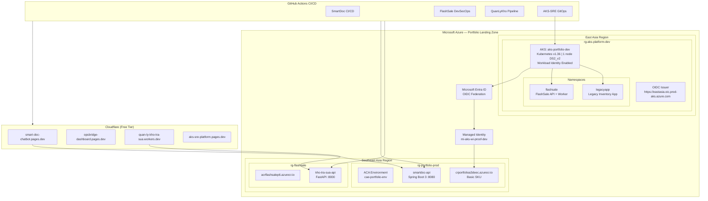

# Architecture Overview

## Hub-Spoke Landing Zone on Azure

## Technology Decisions

| Decision | Choice | Rationale |
|----------|--------|-----------|
| Container Runtime | AKS (eastasia) + ACA (southeastasia) | AKS for GitOps workloads, ACA for scale-to-zero cost savings |
| Registry | ACR Basic SKU | Managed, integrated with AKS via Kubelet Identity |
| Identity | Workload Identity Federation | Zero static secrets — production security pattern |
| Frontend | Cloudflare Pages/Workers | Free tier, global CDN, permanent URLs for CV |
| Event Bus | Kafka (Azure Event Hubs compatible) | Enterprise async pattern for RAG ingestion |
| GitOps | ArgoCD on AKS | Industry standard for K8s continuous delivery |

## ADR Log

- **ADR-012**: Azure first verification — SE-Asia SKUs subscription-blocked, eastasia chosen
- **ADR-014**: AKS over kind for production evidence — real Azure clusters required
- **ADR-015**: Scale-to-zero on ACA for cost control during portfolio phase
