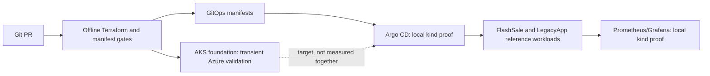

# Architecture and verification boundary

The AKS cluster was deleted on 2026-10-21. Its historical Azure evidence covers
system/user pool isolation, private ACR pull by digest, and a scoped Workload
Identity token exchange. It does **not** prove that Argo CD, Envoy Gateway or
Prometheus/Grafana ran on AKS. Those components were exercised on local kind.

## Ownership and trade-offs

| Decision | Business reason | Trade-off / measured boundary |
|---|---|---|
| Terraform provisions platform infrastructure; application repositories own their workload contracts | Keep cloud boundary and workload release authority separate | Cross-repo source and destination must be validated before Argo sync |
| GitOps reconciles declarative workload state | Detect drift and give a reviewed rollback path | Kind self-heal measured at 21 s for spec drift and 17 s to recreate a deleted Deployment; Azure runtime not measured |
| System pool separated from user pool | Protect critical AKS components from tenant scheduling | Placement proven in transient Azure run; autoscaler scale-out not proven |
| Workload Identity plus kubelet-managed ACR access | Avoid static Azure credentials in the tested paths | Pod token exchange and kubelet image pull are distinct identities; no general claim about every workload |
| Azure-first proof with transient cluster | Demonstrate Azure-only behavior within 10-vCPU quota | Cluster is deleted after validation; no production uptime/SLO history |

## Failure paths to explain

1. A malformed or unowned manifest fails CI before a deployment claim.
2. Manual spec drift or a deleted Argo-owned Deployment is detected and
   reconciled on kind; evidence names the exact context and timing.
3. A missing Azure-specific proof stays **not verified**. Applying a
   NetworkPolicy object is not evidence that unwanted traffic was blocked.
4. A failed deployment uses a reviewed Git revert as the desired-state rollback;
   a live AKS rollback is not claimed in this repository.

Read the [audit matrix](https://github.com/imtarget05/AKS-SRE-Platform/blob/main/docs/evidence/portfolio-audit-2026-10-21.md),
[ADR-014](https://github.com/imtarget05/AKS-SRE-Platform/blob/main/docs/adr/014-azure-first-verification.md),
and [current state](https://github.com/imtarget05/AKS-SRE-Platform/blob/main/docs/engineering/CURRENT_STATE.md).
