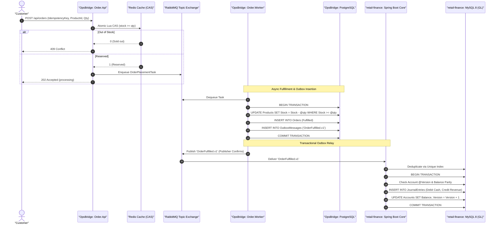
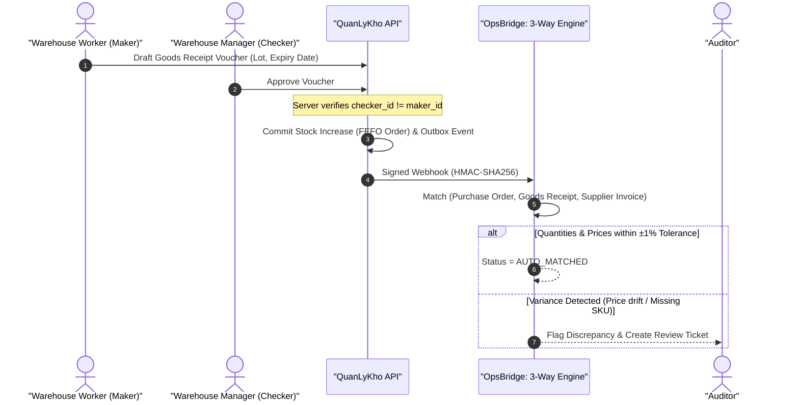
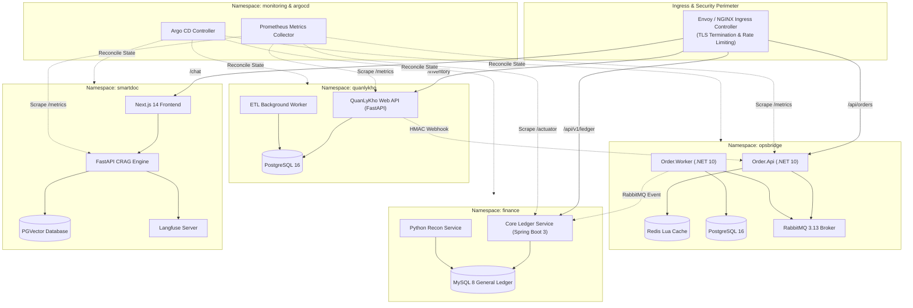

# Unified 5-Repository Architecture & Ecosystem Flow

> **Scope**: Cross-Repository Systems Integration (`OpsBridge`, `QuanLyKho`, `retail-finance-core-platform`, `AKS-SRE-Platform`, `SmartDocumentChatbot`)  
> **Key References**: [Master Architecture Guide](https://github.com/imtarget05/OpsBridge/blob/main/docs/architecture/UNIFIED_CROSS_REPO_ARCHITECTURE.md) · [Portfolio Audit](https://github.com/imtarget05/AKS-SRE-Platform/blob/main/docs/evidence/portfolio-audit-2026-10-21.md)

---

## 1. Executive Platform Architecture

The portfolio consists of five decoupled systems operating across high-throughput commerce, physical warehouse logistics, double-entry financial accounting, conversational AI intelligence, and cloud-native infrastructure automation.

=== "Ecosystem Overview"
    ```mermaid
    flowchart TD
        subgraph Ingress ["API Gateway & Ingress"]
            GW[TLS / Rate-Limited Ingress Controller]
        end

        subgraph TierCommerce ["Commerce & Order Tier"]
            OB["OpsBridge (.NET 10 / C# 13)<br/>• Flash-Sale Admission<br/>• Redis Lua CAS Fast-Fail<br/>• Outbox Event Publisher"]
        end

        subgraph TierLogistics ["Logistics & Warehousing"]
            QLK["QuanLyKho (Python 3.11 / FastAPI)<br/>• Maker-Checker Dual Control<br/>• FEFO Lot Expiration<br/>• Signed Webhooks"]
        end

        subgraph TierFinance ["Financial Ledger Tier"]
            RF["retail-finance-core (Java 17 / Spring Boot 3)<br/>• Double-Entry Bookkeeping<br/>• Optimistic Lock (@Version)<br/>• Daily Python Recon Engine"]
        end

        subgraph TierAI ["AI & Document Intelligence"]
            SD["SmartDocumentChatbot (Next.js / FastAPI)<br/>• Corrective RAG (CRAG)<br/>• Multi-Tenant PGVector Retrieval<br/>• Langfuse Tracing & Circuit Breaker"]
        end

        subgraph SREPlatform ["Cloud-Native SRE Platform"]
            AKS["AKS-SRE-Platform (K8s / GitOps / Calico)<br/>• Zero-Trust Network Isolation<br/>• PDB Zero-Downtime Drains<br/>• Prometheus & Automated SRE Runbooks"]
        end

        GW -->|/api/orders| OB
        GW -->|/inventory| QLK
        GW -->|/api/v1/ledger| RF
        GW -->|/chat| SD

        QLK -->|HMAC Webhook: GoodsReceipt| OB
        OB -->|Outbox Event: OrderFulfilled| RF
        SD -->|Audit Queries & Traces| RF

        AKS -.->|Orchestrates, Isolates & Monitors| OB
        AKS -.->|Orchestrates, Isolates & Monitors| QLK
        AKS -.->|Orchestrates, Isolates & Monitors| RF
        AKS -.->|Orchestrates, Isolates & Monitors| SD
    ```

=== "Invariant Matrix"
    | System | Core Invariant | Guard Mechanism | Verification Gate |
    |---|---|---|---|
    | **OpsBridge** | **Zero Overselling** | Redis Lua CAS admission + Postgres conditional SQL (`Stock >= @qty`) | Concurrency harness: 50 buyers / 10 stock $\rightarrow$ 10 fills, 40 fast-fails |
    | **retail-finance** | **Ledger Parity** | Double-Entry balance ($\sum \text{Debits} = \sum \text{Credits}$) + JPA `@Version` | Testcontainers MySQL integration suite |
    | **QuanLyKho** | **Two-Man Rule** | Maker-Checker separation (`maker_id != checker_id`) + FEFO lots | Pytest maker-checker authorization tests |
    | **AKS-SRE** | **Zero-Downtime Resilience** | Calico zero-trust NetworkPolicies + PDB drain tolerance | Gate harness `tests/test_gates.py` (47 pass) |
    | **SmartDoc** | **Tenant Data Isolation** | Owner-filtered vector queries + Resilience4j circuit breaker | ADR-0001 tenant retrieval validation |

---

## 2. Cross-Repository Lifecycles & Integration Flows

### Scenario 1: Flash Sale Order to General Ledger Settlement



> [!NOTE]
> **No Distributed 2-Phase Commit (2PC)**:
> The system eliminates the distributed dual-write hazard by enclosing order state mutation and the outbox event record within a single local ACID transaction. The downstream financial system relies on idempotent deduplication (`uk_txn_idempotency`) and optimistic locking.

---

### Scenario 2: Warehouse Goods Receipt & 3-Way Reconciliation



---

## 3. C4 Level 2: Container Ecosystem



---

## 4. Kubernetes Zero-Trust Network & Infrastructure Fabric

Workloads run in isolated namespaces governed by Calico NetworkPolicies. Default-deny policies prevent unauthenticated lateral movement.

### Calico Policy Enforcement Matrix

| Source | Destination | Protocol/Port | Action | Security Rationale |
|---|---|---|---|---|
| `ingress-nginx` | Workload APIs | HTTP (8080/8000/3000) | **ALLOW** | Public client ingress through WAF |
| `quanlykho` | `opsbridge/order-api` | HTTP (8080) | **ALLOW** | Authorized HMAC GoodsReceipt webhook |
| `finance` | `opsbridge/rabbitmq` | AMQP (5672) | **ALLOW** | Async consumption of order events |
| `smartdoc` | `finance/mysql` | MySQL (3306) | **DENY** | Zero direct cross-database access |
| `opsbridge` | `finance/core` | ANY | **DENY** | Enforces asynchronous event-driven boundary |
| Any Workload | External Internet | ANY | **DENY** | Egress lockdown (except whitelisted APIs) |

> [!IMPORTANT]
> **PDB Zero-Downtime Guarantee**:
> Every critical application deployment specifies a `PodDisruptionBudget`. During Kubernetes node drains or maintenance windows, the cluster scheduler guarantees at least one replica remains ready to serve traffic without dropping in-flight HTTP connections.

---

## 5. AI Corrective RAG (CRAG) & Advisory Governance

### SmartDocumentChatbot CRAG Routing Hierarchy
1. **Owner-Filtered Retrieval**: Vector search explicitly filters on `owner_username = @current_user` in PGVector, guaranteeing tenant isolation.
2. **Relevance Grading**: A cross-encoder grades retrieved chunks between $0.0$ and $1.0$.
3. **Circuit Breaker Fallback**: If retrieval confidence falls below $0.4$ or times out, a Resilience4j circuit breaker trips to a safe, deterministic keyword search or human escalation prompt.
4. **Langfuse Distributed Tracing**: Every step logs execution traces (`trace_id`, token counts, latencies, retrieval confidence).

### QuanLyKho Advisory Boundary (ADR-0002)
- AI risk scores in warehouse inventory are strictly **advisory**.
- Autonomous state mutations by AI agents are prohibited.
- Model inferences are stamped with a **SHA-256 model provenance checksum**.
