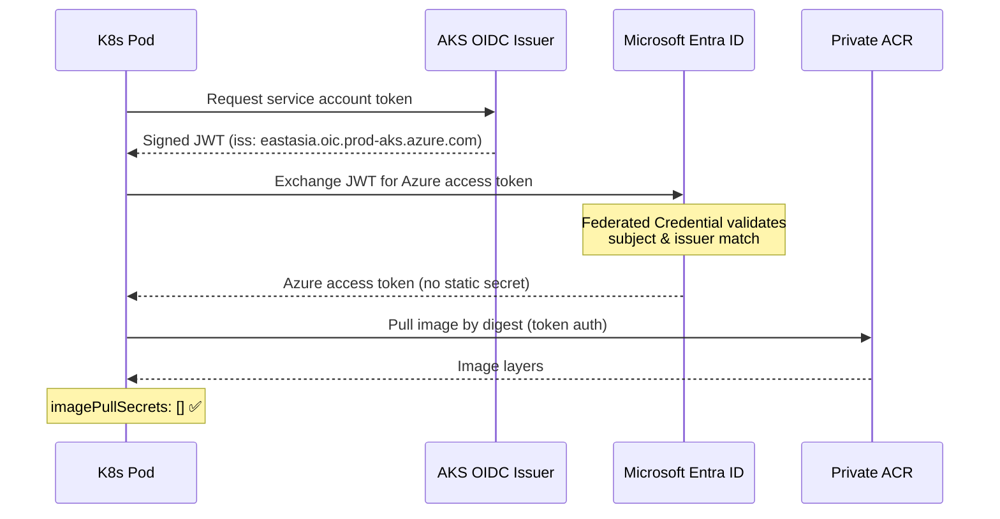

# Workload Identity Evidence

!!! success "Zero Static Secrets — Production Pattern"
    All workloads authenticate to Azure via Workload Identity Federation.
    No Kubernetes Secrets containing Azure credentials.

## What Was Proved



## Resources Created

| Resource | Name | Purpose |
|----------|------|---------|
| User-Assigned MI | `mi-aks-wi-proof-dev` | Federated workload identity |
| Federated Credential | `github-oidc-fed` | GitHub Actions OIDC trust |
| Role Assignment | AcrPull on ACR | Kubelet pulls images |
| AKS OIDC Issuer | Enabled on cluster | Issues service account tokens |

## Verification Command

```bash
# Pod using Workload Identity — no imagePullSecrets
kubectl run wi-test \
  --image=crportfolioa3deec.azurecr.io/test:latest \
  --overrides='{"spec":{"imagePullSecrets":[]}}' \
  --serviceaccount=wi-proof-sa

# Verify token exchange
kubectl exec wi-test -- \
  curl -H "Authorization: Bearer $(cat /var/run/secrets/azure/tokens/azure-identity-token)" \
  https://management.azure.com/subscriptions/a3deec78.../providers/Microsoft.ContainerRegistry/...
```

## Evidence File

Committed at: [`docs/evidence/phase7a/workload-identity-runtime-PASS.md`](https://github.com/imtarget05/AKS-SRE-Platform/blob/main/docs/evidence/phase7a/workload-identity-runtime-PASS.md)
