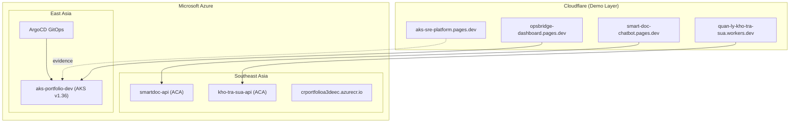

# AKS SRE Platform — Portfolio Evidence

-   :material-cloud: **Azure AKS Live**
    ---
    Cluster `aks-portfolio-dev` provisioned on Azure (EastAsia).
    Kubernetes v1.36 with 1 node running all addons.

    [:octicons-arrow-right-24: AKS Evidence](evidence/aks-live.md)

-   :material-shield-check: **Zero-Trust Identity**
    ---
    Workload Identity Federation — zero static secrets.
    Private ACR pull by digest verified.

    [:octicons-arrow-right-24: Workload Identity Proof](evidence/workload-identity.md)

-   :material-test-tube: **47/47 Gate Tests**
    ---
    All SRE gate tests pass. 16/0 GitOps validation.
    Security scans: 0 HIGH/CRITICAL findings.

    [:octicons-arrow-right-24: Test Results](evidence/test-results.md)

-   :material-book-open: **SRE Runbooks**
    ---
    Production-grade incident response procedures.
    FinOps cost controls & scaling guides.

    [:octicons-arrow-right-24: Runbooks](runbooks/incident-response.md)

## Project Overview

## 4 Portfolio Projects

| # | Project | Demo URL | Stack | Status |
|---|---------|----------|-------|--------|
| 1 | Enterprise RAG Document Intelligence | [smart-doc-chatbot.pages.dev](https://smart-doc-chatbot.pages.dev) | Spring Boot · React · LangChain · Kafka · Redis | ✅ Live |
| 2 | FlashSale Microservices + OpsBridge | [opsbridge-dashboard.pages.dev](https://opsbridge-dashboard.pages.dev) | .NET 10 · CQRS · PostgreSQL · RabbitMQ | ✅ Live |
| 3 | Quản Lý Kho Trà Sữa | [quan-ly-kho-tra-sua.tanmainguyenbinh.workers.dev](https://quan-ly-kho-tra-sua.tanmainguyenbinh.workers.dev) | Flutter Web · FastAPI · PostgreSQL · CF Worker | ✅ Live |
| 4 | AKS SRE Platform | [aks-sre-platform.pages.dev](https://aks-sre-platform.pages.dev) | Terraform · ArgoCD · Prometheus · AKS | ✅ This site |

## Key Technical Highlights

- **GitOps on AKS**: ArgoCD managing `FlashSale-Backend` + `AKS-SRE-Platform` repos
- **Zero-Trust Identity**: Workload Identity Federation — zero static secrets in K8s
- **Event-Driven Architecture**: Kafka backbone for cross-service async communication
- **Observability**: Prometheus + Grafana on AKS; OpenTelemetry instrumentation
- **DevSecOps**: Trivy scans, 0 HIGH/CRITICAL findings across all 4 repos
- **FinOps**: Scale-to-zero Container Apps, AKS node pool cost controls

---

*Built by [Tan Nguyen Binh](https://github.com/imtarget05) · Contact: tanmainguyenbinh@gmail.com*
