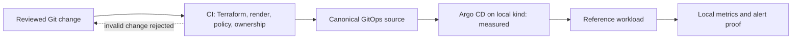

# AKS SRE Platform — evidence, not a live cluster

> **Current state (2026-10-21):** `aks-portfolio-dev` and its resource group were
> deleted after a transient Azure validation run. The AKS evidence below is
> historical; the local kind environment is a separate dry-run profile. See the
> [teardown record](https://github.com/imtarget05/AKS-SRE-Platform/blob/main/docs/runbooks/azure-teardown-runbook.md)
> and [engineering checkpoint](https://github.com/imtarget05/AKS-SRE-Platform/blob/main/docs/engineering/CURRENT_STATE.md).

This project addresses a platform team's need to review infrastructure changes,
reject invalid manifests before deployment, and say precisely which runtime
claims have been measured. The reference workload is deliberately small; its
`/sync` route is a no-op, not an enterprise inventory integration.

| Capability | Evidence level | Source |
|---|---|---|
| AKS node placement, private ACR pull by digest, federated Workload Identity token exchange | **Historical Azure validation**, cluster deleted | [AKS run](evidence/aks-live.md) · [identity](evidence/workload-identity.md) |
| Argo CD reconciliation, Gateway API/Envoy, Prometheus/Grafana alert cycle | **Local kind only** | [architecture](architecture/overview.md) |
| HPA/Cluster Autoscaler, NetworkPolicy deny, PDB/drain, 30-day SLO, DR | **Not verified** | [claim matrix](https://github.com/imtarget05/AKS-SRE-Platform/blob/main/docs/evidence/portfolio-audit-2026-10-21.md) |

## Delivery path

The GitOps, Gateway and observability nodes in this diagram were tested on
**kind**, not AKS. A fresh AKS run would need a saved reviewed Terraform plan,
explicit owner approval, runtime probes, and teardown under the repository's
cost-safety rules.

## Four-repository portfolio

This site owns the **AKS-SRE-Platform** claims. The other products have their
own code and evidence: [OpsBridge](https://github.com/imtarget05/OpsBridge),
[QuanLyKho](https://github.com/imtarget05/QuanLyKho), and
[SmartDocumentChatbot](https://github.com/imtarget05/Smart-Document-Chatbot).
Their current deployment or test status must be checked in those repositories;
the existence of a public demo URL does not establish a healthy business API.
The [portfolio interview index](https://github.com/imtarget05/AKS-SRE-Platform/blob/main/docs/PORTFOLIO_INTERVIEW_CHEATSHEET.md)
maps the cross-project narrative and its limits.
