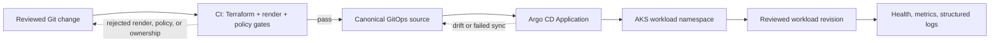

# AKS-SRE Platform — Interview Kit

## One-page business brief

**Problem.** A team needs a repeatable platform path for a small, security-aware
workload: infrastructure changes must be reviewed before they reach Azure,
Kubernetes manifests must be rendered and policy-checked, and operational
claims must be traceable to the environment where they were measured.

**Solution.** This repository provides an Azure AKS foundation, GitOps source
validation, manifest/policy gates, a repo-owned SRE demo API, and a manually
promoted QuanLyKho GitOps reference. The small workloads demonstrate platform
contracts (health, structured logs, non-root/read-only filesystem, and GitOps
ownership) without pretending that the interview environment is a production
deployment.

**Business outcome.** A platform engineer can show a reviewer which invariants
are checked before deployment, distinguish local/kind proof from Azure proof,
and make a controlled Azure validation run without leaving a cost-generating
cluster behind.

## Architecture and failure path



The failure boundary is deliberate: a bad manifest, an orphan resource, or a
GitOps destination outside the permitted AppProject fails before it is called a
deployment. The repository validator also reports an unavailable external
source as `NOT_PRESENT`; it does not turn missing input into a pass.

```mermaid
sequenceDiagram
    participant Author
    participant CI
    participant GitOps as Canonical GitOps source
    participant Argo as Argo CD
    participant Workload as Reviewed workload
    Author->>CI: Pull request
    CI->>CI: Terraform tests, render, policy, ownership checks
    alt Gate fails
        CI-->>Author: Exact failed invariant; no deployment claim
    else Gate passes and source switch is approved
        CI->>GitOps: Reviewed source is available
        Argo->>GitOps: Reconcile desired state
        Argo->>Workload: Apply reviewed manifest
        Workload-->>Argo: Readiness/health state
    end
```

## Five-minute local demo

Use the read-only, state-accurate walkthrough in
[`interview-demo/local-platform.md`](interview-demo/local-platform.md). From
the repository root, run:

```bash
./scripts/demo-local-platform.sh
```

The runner checks the three-node local kind cluster, the Argo CD control plane
and current GitOps status, the host-based QuanLyKho API/UI, the SRE demo API
unit tests, platform gate regressions, and Kustomize rendering. It does not
apply manifests, sync Argo CD, create users, change Kubernetes context, or
mutate Azure.

Talking points:

1. **Local is not production.** The current kind foundation and Argo CD control
   plane are local evidence only.
2. **Promotion is deliberate.** The pinned QuanLyKho Application is
   `OutOfSync`/`Missing` because it is manual-sync and has not been approved.
   The namespace has no application workloads.
3. **Checks have bounded meaning.** Unit tests prove service behavior;
   Kustomize rendering proves manifest composition. Neither proves a deployed
   workload.
4. Open [`CURRENT_STATE.md`](engineering/CURRENT_STATE.md) to distinguish
   current local state from historical kind drills and Azure evidence.

## Trade-offs and decisions

- [ADR-014](adr/014-azure-first-verification.md): local kind is useful for
  authoring and OSS profiling, but it is not substituted for Azure-only
  properties such as workload identity or enforced network policy.
- [ADR-015](adr/015-legacyapp-subtree-import.md): LegacyApp lives in this repo
  as a subtree-owned reference workload. Its Argo source switch remains a
  controlled, approval-gated action.
- `scripts/bootstrap.sh` pins all operations to the local kind context by
  default, validates that context before mutation, and applies maintained
  platform paths only. It refuses `legacyapp.yaml` unless
  `APPLY_LEGACYAPP=1` is set; that guard does not grant approval to sync a
  cluster.

## Non-claims

- `/sync` is currently a **no-op reference endpoint**, not an inventory sync,
  source-of-record, or enterprise integration.
- A passing local/kind gate is not Azure evidence. In particular, skipped OIDC
  work is `NOT_VERIFIED`, never a passing Azure proof.
- The project does not claim a current deployed Argo source switch, live
  OIDC/Key Vault validation, NetworkPolicy deny probe, HPA/cluster-autoscaler
  proof, production SLO history, or a DR exercise.
- No Azure apply, Argo sync, or destructive migration was performed to produce
  this interview kit.

## Evidence index

| Claim | Evidence |
|---|---|
| Canonical-source and negative manifest controls | [`tests/test_gates.py`](../tests/test_gates.py) |
| Current, environment-labelled state | [`engineering/CURRENT_STATE.md`](engineering/CURRENT_STATE.md) |
| Subtree boundary and source-switch decision | [ADR-015](adr/015-legacyapp-subtree-import.md) |
| Azure-vs-local verification policy | [ADR-014](adr/014-azure-first-verification.md) |
| Local platform walkthrough | [`interview-demo/local-platform.md`](interview-demo/local-platform.md) |
| Commit-pinned business-to-evidence claim matrix and prioritized gaps | [`evidence/portfolio-audit-2026-10-21.md`](evidence/portfolio-audit-2026-10-21.md) |
| Four-product narrative and three-role Q&A | [`PORTFOLIO_INTERVIEW_CHEATSHEET.md`](PORTFOLIO_INTERVIEW_CHEATSHEET.md) |
