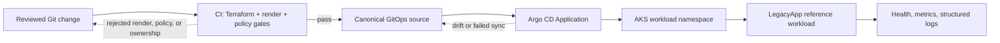

# AKS-SRE Platform — Interview Kit

## One-page business brief

**Problem.** A team needs a repeatable platform path for a small, security-aware
workload: infrastructure changes must be reviewed before they reach Azure,
Kubernetes manifests must be rendered and policy-checked, and operational
claims must be traceable to the environment where they were measured.

**Solution.** This repository provides an Azure AKS foundation, GitOps source
validation, manifest/policy gates, and a small Node.js LegacyApp reference
workload. The workload is intentionally modest: it demonstrates the platform
contracts (health, structured logs, non-root/read-only filesystem, and GitOps
ownership) without pretending to be a deployed enterprise inventory service.

**Business outcome.** A platform engineer can show a reviewer which invariants
are checked before deployment, distinguish local/kind proof from Azure proof,
and make a controlled Azure validation run without leaving a cost-generating
cluster behind.

## Architecture and failure path



The failure boundary is deliberate: a bad manifest, an orphan resource, or a
GitOps destination outside the permitted AppProject fails before it is called a
deployment. The repository validator also reports an unavailable external
source as `NOT_PRESENT`; it does not turn missing input into a pass.

```mermaid
sequenceDiagram
    participant Author
    participant CI
    participant GitOps as Canonical GitOps source
    participant Argo as Argo CD
    participant Workload as LegacyApp
    Author->>CI: Pull request
    CI->>CI: Terraform tests, render, policy, ownership checks
    alt Gate fails
        CI-->>Author: Exact failed invariant; no deployment claim
    else Gate passes and source switch is approved
        CI->>GitOps: Reviewed source is available
        Argo->>GitOps: Reconcile desired state
        Argo->>Workload: Apply workload manifest
        Workload-->>Argo: Readiness/health state
    end
```

## Five-minute demo

Run these commands from the repository root. They require no Azure mutation:

```bash
.venv/bin/python tests/test_gates.py
cd apps/legacy-inventory/src && npm test
cd ../../..
kubectl kustomize platform/envoy-gateway/gateway >/dev/null
```

Talk through the results:

1. `test_gates.py` proves both success and negative controls—for example, a
   missing resource or an AppProject destination violation must fail.
2. The LegacyApp tests prove health, JSON 404/error behavior, request logging
   and its current `/sync` reference behavior.
3. Rendering a kustomize root proves syntactic composition only. It is not an
   AKS deployment claim. In the gate output, show a **negative fixture** such
   as `G8 orphan manifest detection`: the fixture must fail validation while
   the regression assertion passes. This is the failure path of the demo.
4. Open [`CURRENT_STATE.md`](engineering/CURRENT_STATE.md) and map each claim to
   `LOCAL`, `KIND`, `CI`, or `AZURE_VALIDATION` evidence.

## Trade-offs and decisions

- [ADR-014](adr/014-azure-first-verification.md): local kind is useful for
  authoring and OSS profiling, but it is not substituted for Azure-only
  properties such as workload identity or enforced network policy.
- [ADR-015](adr/015-legacyapp-subtree-import.md): LegacyApp lives in this repo
  as a subtree-owned reference workload. Its Argo source switch remains a
  controlled, approval-gated action.
- `scripts/bootstrap.sh` validates its inputs and applies maintained platform
  paths only. It refuses `legacyapp.yaml` unless `APPLY_LEGACYAPP=1` is set;
  that guard does not grant approval to sync a cluster.

## Non-claims

- `/sync` is currently a **no-op reference endpoint**, not an inventory sync,
  source-of-record, or enterprise integration.
- A passing local/kind gate is not Azure evidence. In particular, skipped OIDC
  work is `NOT_VERIFIED`, never a passing Azure proof.
- The project does not claim a current deployed Argo source switch, live
  OIDC/Key Vault validation, NetworkPolicy deny probe, HPA/cluster-autoscaler
  proof, production SLO history, or a DR exercise.
- No Azure apply, Argo sync, destructive migration, or cloud cost was created
  to produce this interview kit.

## Evidence index

| Claim | Evidence |
|---|---|
| Canonical-source and negative manifest controls | [`tests/test_gates.py`](../tests/test_gates.py) |
| Current, environment-labelled state | [`engineering/CURRENT_STATE.md`](engineering/CURRENT_STATE.md) |
| Subtree boundary and source-switch decision | [ADR-015](adr/015-legacyapp-subtree-import.md) |
| Azure-vs-local verification policy | [ADR-014](adr/014-azure-first-verification.md) |
| Local platform walkthrough | [`interview-demo/local-platform.md`](interview-demo/local-platform.md) |
| Commit-pinned business-to-evidence claim matrix and prioritized gaps | [`evidence/portfolio-audit-2026-10-21.md`](evidence/portfolio-audit-2026-10-21.md) |
| Four-product narrative and three-role Q&A | [`PORTFOLIO_INTERVIEW_CHEATSHEET.md`](PORTFOLIO_INTERVIEW_CHEATSHEET.md) |
