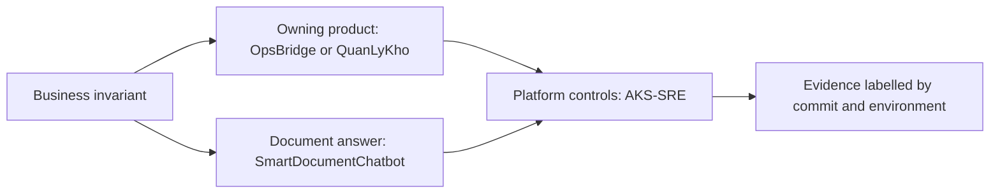

# Portfolio interview defense — four audited products

**Audit date:** 2026-10-21. This guide connects four local repositories for
Solution Architect, AI Engineer and Backend/Platform interviews. Each repo's
own audit records its exact HEAD and run results; a historical PASS is never
silently promoted to a current deployment claim.

Local checkout paths in the table are **relative to the AKS-SRE-Platform repo
root** (the four checkouts are sibling directories under `Downloads/`), not
relative to this Markdown file. On GitHub, open the linked owning repository
and use the stated path inside it.

| Product | Enterprise problem | Owning evidence | Honest limit |
|---|---|---|---|
| [AKS-SRE-Platform](https://github.com/imtarget05/AKS-SRE-Platform) | Review, deploy, observe and recover shared workloads at controlled Azure cost | [AKS audit](evidence/portfolio-audit-2026-10-21.md) · [local interview kit](INTERVIEW_KIT.md) | AKS cluster deleted; GitOps/Gateway/alert runtime proof is on kind |
| [OpsBridge](https://github.com/imtarget05/OpsBridge) | Prevent oversell and reconcile asynchronous operational events | Local checkout: `../OpsBridge/docs/evidence/portfolio-audit-2026-10-21.md` and `docs/interview-notes/portfolio-defense-2026-10-21.md` | Local Testcontainers **39/39**, harness regressions **6/6**, disposable 50/10 **10 accepted / 40 rejected / stock 0 / 10 orders**; remote CI and durable reservation repair remain open |
| [QuanLyKho](https://github.com/imtarget05/QuanLyKho) | Control lot/expiry inventory and require a different human checker before posting | Local checkout: `../QuanLyKho/docs/PORTFOLIO_AUDIT_2026-10-21.md` and `scripts/demo_ai_checker.sh` | Cash is a simulation; AI may advise but cannot approve or post |
| [SmartDocumentChatbot](https://github.com/imtarget05/Smart-Document-Chatbot) | Answer over owned documents with citations and abstain without evidence | Local checkout: `../SmartDocumentChatbot/docs/PORTFOLIO_ENTERPRISE_AUDIT.md` and `eval/portfolio_demo/` | Local direct-route guard, principal binding, batch-delete/cache isolation fixes and **395/395** backend retest; agent demo and live Azure RAG are separate claims; serving HITL crash window remains open |

The previously featured **MAIA** project is external to these four audited
checkouts. Its Azure, MCP, RL and HITL claims require an independent audit in
that owning repository; this guide does not certify them or offer a MAIA live
demo script.

## One architecture story

The products are **not** asserted to be one deployed distributed system.
OpsBridge owns order/operations consistency. QuanLyKho owns tea-shop stock
posting and human approval. SmartDocumentChatbot owns document Q&A and a
separate AI-agent experiment. AKS/SRE demonstrates shared platform controls.
The architectural link is the decision method: business need → use case →
failure mode → simplest sufficient mechanism → trade-off → measured evidence.

## Ten-minute offline walkthrough

1. **AKS/SRE (2 min):** Run `.venv/bin/python tests/test_gates.py`; show an
   expected negative fixture failing inside the harness and the final 47/47
   assertion result. Open the [kind self-heal proof](evidence/local-platform/2026-10-21-recreate/selfheal-reverification-2026-10-21.md)
   and [historical Azure identity proof](evidence/phase7a/workload-identity-runtime-PASS.md)
   side by side. State that the Azure cluster was deleted.
2. **OpsBridge (2 min):** In the owning checkout, show the disposable
   50-buyer/10-stock run: 10 accepted, 40 rejected, stock 0 and 10 persisted
   orders. Explain that `202 Accepted` precedes settlement, then show
   at-least-once delivery, outbox/inbox, Saga compensation and the currently
   open durable-repair gap using its dated audit.
3. **QuanLyKho (2 min):** Use its local isolated-database demo to show a maker
   submits a lot/expiry movement, a different checker approves, and a duplicate
   or unauthorized approval does not post again. The AI recommendation is
   visible but has no write authority.
4. **SmartDocumentChatbot (3 min):** Show a cited answer and honest abstention,
   then a local multi-agent/HITL demo that pauses before a side effect. Show
   reject, approve and replay protection. Point to the new local guard on
   direct mutation routes and owner-scoping fixes, but state that serving HITL
   still has a crash window. Explain which route the Azure backend actually
   served at its last verified run.
5. **Feedback learning (1 min):** Show offline contextual-bandit comparison
   and tiny-model RLHF before/after artifacts. Both are demos; no learned
   policy controls production traffic.

Use saved evidence when a service is unavailable. Do not present a URL, badge,
diagram or synthetic fixture as proof that the whole stack is live.

## Questions that expose weak claims

### Solution Architect

**Why do these four systems not share one database or one agent?** Their
authoritative state and risk differ. Orders, tea-shop stock and documents
have separate owners and failure boundaries. A shared platform can supply
deployment controls; cross-product transactions or an autonomous global agent
would add coupling without a demonstrated business requirement. Show the
individual repo architecture and ADRs.

**Why microservices/Saga in OpsBridge but a modular monolith in QuanLyKho?**
OpsBridge has an asynchronous order/payment/operations workflow with explicit
compensation and delivery gaps. QuanLyKho's maker–checker posting benefits
from one PostgreSQL transaction and one business authority. Describe the
observed constraint and consistency trade-off, then show each repo's tests.

**What is actually live on Azure AKS?** Nothing in this portfolio's AKS
validation cluster now: it was deleted on 2026-10-21. Historical Azure
evidence covers placement, private ACR pull and token exchange; Argo CD,
Gateway and observability were measured on local kind. Show the
[AKS audit](evidence/portfolio-audit-2026-10-21.md).

### Backend / Platform

**Does `202 Accepted` mean an order is committed?** No. It means an async
request was accepted for processing. A status lookup and idempotency key are
required; the PostgreSQL write remains authoritative. Under at-least-once
delivery, duplicate messages must not create a second transition. Show the
OpsBridge concurrency and inbox/outbox evidence. The current disposable local
run had exact 10/40 fill; it is one run, not a throughput guarantee.

**Can Argo CD self-heal an unhealthy application?** The kind proof covers a
manual `spec.replicas` change and a deleted Argo-owned Deployment (21 s and
17 s observations). It does not prove business recovery, zero downtime,
Azure runtime, or an SLO. A bad Git desired state can also be faithfully
reconciled; CI review and rollback remain necessary.

**Did NetworkPolicy block traffic on AKS?** The objects were applied, but
the forbidden-traffic negative probe was not completed. Enforcement is
`NOT_VERIFIED`; the test needed to make the claim is in the
[audit](evidence/portfolio-audit-2026-10-21.md).

### AI Engineer

**What does a citation prove?** It shows the retrieved source that the answer
claims to use. It does not by itself prove entailment or correctness. Run an
answerable query and a no-evidence query, then inspect the owning repo's
evaluation and owner-isolation tests.

**Is SmartDocumentChatbot's LangGraph HITL its verified Azure serving path?**
No such blanket claim is justified. The Spring backend can route to agent
and fall back to CRAG; the last verified Azure chat response used direct RAG.
Its local interrupt demo and production approval implementation must be
described separately. Direct mutation routes now fail closed locally even
with an internal token, but the serving approval may be consumed before its
side effect succeeds; a crash can leave an approved action unexecuted.

**Did the latest SmartDocumentChatbot security changes pass the backend suite?**
The working-tree retest completed **75 suites / 395 tests / 0 failures**. One
earlier full run hit an asynchronous ingestion timing failure, so report the
successful rerun and the first-run flake together. The direct-route,
principal-owner, batch-delete and cache-isolation fixes are local code/test
results; no new Azure deployment or cross-tenant red-team audit is claimed.

**Is the contextual bandit or RLHF model in production?** No. The bandit
compares read-only routes offline with logged action probabilities and reward.
The tiny-model RLHF run demonstrates a real policy update on synthetic
preferences; its held-out measurements decide what improved, and it makes
no enterprise-quality or production-promotion claim.

## Before each interview

Record the four HEAD SHAs; rerun each owning repo's canonical commands; label
local, CI, Azure historical and demo results separately; use only numbers
from the current run or a clearly dated historical artifact. If a required
service (for example Docker/Testcontainers or an LLM provider) is unavailable,
say exactly which tests were blocked and show the saved evidence without
calling it a fresh PASS.
