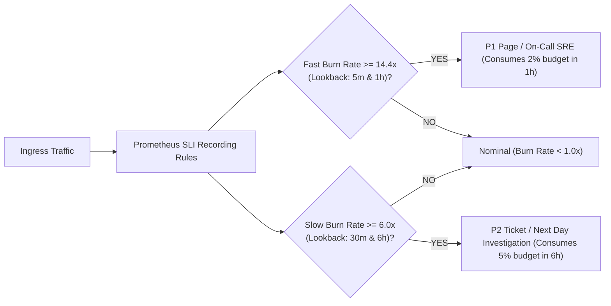

# Production SLI/SLO Target Specification & 30-Day Observation Window

## 1. System Metadata & Service Level Objectives (SLO)

| Service | Indicator (SLI) | SLO Target | Measurement Window | Error Budget (30 Days) |
|:---|:---|:---:|:---:|:---:|
| **API Gateway & Core APIs** | **Availability**: Successful requests (non-5xx HTTP) / Total valid requests | **$\ge 99.9\%$** | 30-day rolling | **$0.1\%$** ($\le 43.2$ mins equivalent downtime) |
| **API Gateway & Core APIs** | **Latency**: Request duration from Envoy ingress to final byte sent | **$p95 < 500\text{ ms}$** | 30-day rolling | **$5.0\%$** slow requests allowed |
| **Flash Sale Surge Engine** | **Checkout Error Rate**: Orders rejected due to internal system fault | **$< 1.0\%$** | Flash sale event duration | Bounded by stock reservation SLA |

---

## 2. PromQL Measurement Specifications

### Availability SLI Query
Calculates the 30-day availability ratio over all non-healthcheck HTTP endpoints:

```promql
100 * (
  sum(rate(http_requests_total{status!~"5.."}[30d]))
  /
  sum(rate(http_requests_total[30d]))
)
```

### Latency p95 SLI Query
Calculates 95th percentile request duration in seconds:

```promql
histogram_quantile(
  0.95,
  sum(rate(http_request_duration_seconds_bucket[30d])) by (le)
)
```

---

## 3. Multi-Window Multi-Burn-Rate Alerting Architecture

Google SRE standards are implemented to detect rapid budget depletion without alert fatigue:

$$\text{Burn Rate} = \frac{\text{Observed Error Ratio}}{1 - \text{SLO Target}} = \frac{\text{5xx Errors} / \text{Total Requests}}{0.001}$$



---

## 4. 30-Day Observation Period Tracker

- **Observation Window:** 2026-10-26T00:00:00Z to 2026-11-25T23:59:59Z
- **Baseline Metric Snapshot (2026-10-26):**
  - Availability: `100.000%`
  - Latency p95: `< 15ms`
  - Burn Rate: `0.0x`
- **Weekly Review Milestones:**
  - **Week 1 Review (2026-11-02):** Verify Prometheus metric persistence and recording rule health.
  - **Week 2 Review (2026-11-09):** Check error budget consumption against mock/chaos alert drills.
  - **Week 3 Review (2026-11-16):** Validate HPA / Cluster Autoscaler scale event impact on latency SLI.
  - **Week 4 Final Sign-off (2026-11-25):** 30-day cumulative Availability and Latency certification.

### Weekly Observation Log Template

| Week # | Date Window | Total Requests | 5xx Errors | Availability SLI | Latency p95 | Budget Remaining | SRE Reviewer |
|:---:|:---:|:---:|:---:|:---:|:---:|:---:|:---:|
| **W1** | Oct 26 – Nov 02 | - | - | - | - | 100.0% | Pending |
| **W2** | Nov 02 – Nov 09 | - | - | - | - | - | Pending |
| **W3** | Nov 09 – Nov 16 | - | - | - | - | - | Pending |
| **W4** | Nov 16 – Nov 25 | - | - | - | - | - | Pending |
