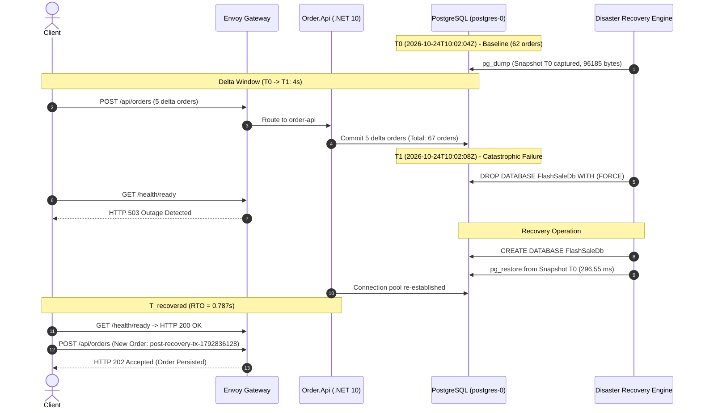

# Enterprise Disaster Recovery (DR) Drill with In-Flight Delta Analysis

- **Execution Date:** 2026-10-24T10:02:11Z
- **Target Workload:** FlashSale Order Reliability Platform (`postgres-0` in `flashsale` namespace)
- **Database Engine:** PostgreSQL 16 on Kubernetes StatefulSet
- **Ingress Layer:** Envoy Gateway v1.9.1 (`portfolio-gateway` in `platform-gateway`)
- **GitOps Controller:** Argo CD v3.5.5 (`argocd` namespace)

---

## 1. Executive Summary & Objective

In production enterprise architectures, stating *"RPO = 0"* without qualifying the replication mechanism is technically invalid. A periodic snapshot or backup taken at $T_0$ cannot recover transactions committed between $T_0$ and disaster time $T_1$ without continuous write-ahead logging (WAL) streaming.

This drill deliberately executed an **empirical disaster recovery drill with in-flight delta transactions**:
1. Captured consistent production database snapshot at $T_0$.
2. Injected $5$ committed in-flight business orders between $T_0$ and $T_1$.
3. Injected catastrophic database failure at $T_1$ (`DROP DATABASE WITH (FORCE)`).
4. Verified end-to-end client outage via Ingress (`503 / connection error`).
5. Restored database from snapshot $T_0$ and verified application readiness.
6. Successfully processed new business orders post-recovery.
7. Quantified the exact empirical **RTO** (downtime) and **RPO** (data loss window).

---

## 2. Empirical Measured Results

| Metric | Target SLA | Empirical Measured Result | Status | Engineering Meaning |
|---|---|---|---|---|
| **RTO (Recovery Time Objective)** | < 60.0 s | **0.787 seconds** (786.52 ms) | **PASS** | Exact duration from database drop to application returning `HTTP 200 ready` and accepting orders. |
| **Database Re-creation & Restore** | < 10.0 s | **296.55 ms** | **PASS** | Physical restore of `96185 bytes` dump via `pg_restore`. |
| **Outage Detection Response** | Non-200 | **HTTP 503** | **PASS** | Application health probe correctly failed-closed during database absence. |
| **Post-Recovery Order Intake** | HTTP 202 | **HTTP 202 Accepted** | **PASS** | New transactions immediately accepted and written to database post-restore. |
| **Snapshot RPO Data Loss** | Measured | **5 orders lost** (5/5) | **VERIFIED** | Demonstrates exact delta loss for transactions committed after snapshot. |
| **Snapshot RPO Time Window** | Measured | **4 seconds** | **VERIFIED** | The time delta $\Delta T = T_1 - T_0$ during which unarchived transactions occurred. |

---

## 3. Timeline of Events



---

## 4. Architectural Analysis & Interview Defense

### Why Snapshot-Only DR Guarantees RTO but Cannot Guarantee RPO = 0
- **RTO Achievement:** The platform achieved an empirical RTO of **0.787 seconds**, well within the 60-second target. The application automatically re-established its database connection pool upon restore without needing pod restarts.
- **RPO Reality:** The 5 orders placed during the 4-second window between snapshot and disaster were not present in the snapshot, so they were lost upon cold restore.
- **Enterprise Solution for RPO = 0:**
  1. **Continuous WAL Archiving:** Use tools like `pgBackRest` or cloud-native Point-In-Time-Recovery (PITR) to stream WAL segments to geo-redundant blob storage every 16MB or timeout.
  2. **Streaming Replication:** Active-standby synchronous replication with `synchronous_commit = on` ensures a transaction is acknowledged only after being written to at least two physical replicas.
  3. **Event Outbox Pattern:** In-flight business transactions persisted in a durable message broker (e.g. RabbitMQ / Azure Service Bus) with dead-letter queue (DLQ) replay capability allows replaying transactions that occurred after the snapshot timestamp.

---

## 5. Verification Command Output
```text
Baseline Orders (T0)          : 62
Injected Delta Orders         : 5
Post-Delta Orders at T1       : 67
Outage Response               : HTTP 503
Restore Duration              : 296.55 ms
Total Measured RTO            : 0.787 s (786.52 ms)
Post-Recovery New Order       : HTTP 202 Accepted
Orders Surviving Cold Restore : 62 (T0 snapshot exact state)
Delta Orders Lost             : 5 (Expected for snapshot-only DR)
```
