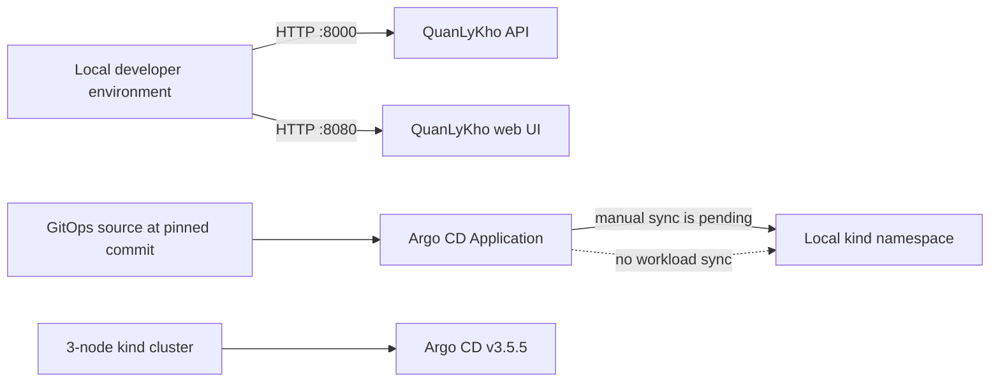

# Local Interview Demo

This walkthrough is intentionally limited to components that are currently
available in the local environment. It does not claim that product workloads
are deployed to kind or Azure.

## Verified topology



The local `local-platform` kind cluster has three Ready nodes. Argo CD is
installed and its seven components are Ready. The `portfolio` AppProject and
the `quanlykho` Application are present. The Application points at
`573dfadc96ff843171f0b127dbf0b7fab4cc7feb` and is currently `OutOfSync` /
`Missing`; it uses manual promotion and has not been synced. The QuanLyKho
namespace has no application workloads.

Separately, the QuanLyKho API readiness endpoint and web UI are running on the
host at `127.0.0.1:8000` and `127.0.0.1:8080`. They are not running inside
kind. The repository-owned SRE demo API is unit-tested but is not deployed to
this cluster. Envoy Gateway, Prometheus, Grafana, and LegacyApp are not part of
this live walkthrough.

## Run the read-only verification

From the AKS-SRE-Platform repository root:

```bash
./scripts/demo-local-platform.sh
```

The runner pins all cluster reads to `kind-local-platform` by default. It
checks node and Argo readiness, prints the current Application state, probes
the two local QuanLyKho endpoints, runs the SRE demo API unit tests and
platform gate regression tests, then renders three Kustomize roots.

Override the context or local URLs only when your environment differs:

```bash
KUBE_CONTEXT=kind-local-platform \
QUANLYKHO_API_URL=http://127.0.0.1:8000 \
QUANLYKHO_WEB_URL=http://127.0.0.1:8080 \
./scripts/demo-local-platform.sh
```

## Suggested interview narrative

1. **Separate evidence from claims.** Show the three local kind nodes and the
   Ready Argo CD control plane. Explain that this proves a local control-plane
   setup, not an AKS deployment.
2. **Show promotion safety.** The Application is pinned to an immutable
   revision, but remains `OutOfSync` / `Missing` because sync is manual and has
   not been approved. Do not sync it during the interview: the current image
   and runtime dependencies have not been verified for this cluster.
3. **Show application quality checks.** The runner probes the host-based
   QuanLyKho API/UI, runs SRE demo API unit tests, and checks platform gates.
   The manifest render checks prove composition, not runtime deployment.
4. **Be explicit about cloud state.** The Azure cluster has not been deployed
   by this walkthrough. Do not describe the local kind cluster as production
   or claim that production was redeployed.

## Non-claims

- No application workload is currently synced into kind.
- No Envoy route, Prometheus target, Grafana dashboard, or LegacyApp endpoint
  is claimed as live by this walkthrough.
- The QuanLyKho API and UI checks are local host processes, not kind services.
- The runner does not apply manifests, sync Argo CD, create test users, change
  the current kubeconfig context, or mutate Azure.
