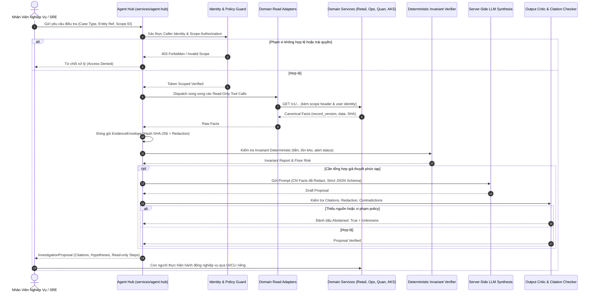

# Agent Hub: Threat Model & Data-Flow Architecture

## 1. Kiến Trúc Luồng Dữ Liệu (Data-Flow Architecture)

Hệ thống Agent Hub đóng vai trò làm trung tâm điều phối điều tra (Investigation Orchestrator). Luồng dữ liệu tuân thủ nghiêm ngặt mô hình Read-Only, kiểm soát phạm vi (scope boundary) và xác thực đa tầng:

---

## 2. Mô Hình Đe Dọa (STRIDE Threat Model)

| Mối Đe Dọa | Phân Loại STRIDE | Kịch Bản Tấn Công | Biện Pháp Kiểm Soát & Giảm Thiểu |
| :--- | :--- | :--- | :--- |
| **Spoofing Identity** | Spoofing | Kẻ tấn công giả mạo token của Auditor hoặc Checker để gửi yêu cầu phân tích dữ liệu nhạy cảm. | Xác thực JWT / mTLS tại cổng vào của Hub; Domain service giải mã và kiểm tra lại chữ ký số trước khi trả lời facts. |
| **Tampering Evidence** | Tampering | Can thiệp làm sai lệch dữ liệu bằng chứng giữa các bước xử lý hoặc trong database của Hub. | Mỗi `EvidenceEnvelope` sinh ra đều có `evidence_hash` tính bằng SHA-256 trên nội dung facts. Hub kiểm tra lại hash trước khi chuyển cho Verifier và Critic. |
| **Repudiation** | Repudiation | Người vận hành từ chối trách nhiệm về quyết định đã đưa ra sau khi đọc đề xuất của Agent. | Hub ghi log audit bất biến (`audit_logs`) lưu vết: ai yêu cầu, đề xuất của AI tại thời điểm đó (version, SHA), và quyết định phê duyệt/từ chối của con người. |
| **Information Disclosure** | Info Disclosure | Người dùng ở Chi Nhánh A yêu cầu điều tra phiếu kiểm kê của Chi Nhánh B; hoặc rò rỉ PII/thẻ tín dụng sang LLM. | 1. **Data Sovereignty:** Domain service lọc theo `scope_id` (404/403 nếu sai chi nhánh). 2. **PII Masking:** Module Redactor tự động che số thẻ, CCCD, tên khách hàng trước khi ra LLM. |
| **Denial of Service** | DoS | Gửi hàng loạt case điều tra để làm cạn kiệt ngân sách token LLM hoặc quá tải backend domain. | Áp dụng Rate Limiting tại Hub, caching kết quả theo `entity_ref` + `record_version`, và fallback về rule-based analysis khi tải cao. |
| **Elevation of Privilege** | Elevation of Priv | Prompt Injection: Người dùng chèn nội dung vào ghi chú phiếu kho hoặc runbook nhằm ép Agent gọi tool thay đổi dữ liệu hoặc cấp quyền admin. | 1. **Tool Allowlist:** Hub chỉ sở hữu Read Tools, hoàn toàn không có mutation tool trong registry. 2. **Output Critic:** Kiểm tra nghiêm ngặt schema đầu ra; loại bỏ bất kỳ shell command thực thi nào. |

---

## 3. Quy Tắc Redaction và Bảo Vệ PII

Trước khi dữ liệu được chuyển đến LLM Provider (Google Gemini, OpenAI, v.v.), `EvidenceEnvelope` bắt buộc phải qua pipeline làm sạch:
1. **Số tài khoản / Thẻ ngân hàng:** Chỉ giữ lại 4 số cuối (ví dụ: `****-****-****-1234`).
2. **Số tiền giao dịch đối soát:** Được chuẩn hóa thành số thực định dạng cố định, không kèm ghi chú chứa tên cá nhân.
3. **Mã định danh khách hàng:** Hash bằng salt dùng một lần trong phiên điều tra (pseudonymization).
4. **API Keys / Secrets:** Regex quét tự động loại bỏ chuỗi có định dạng Bearer, Password, Private Key khỏi log và bằng chứng.
