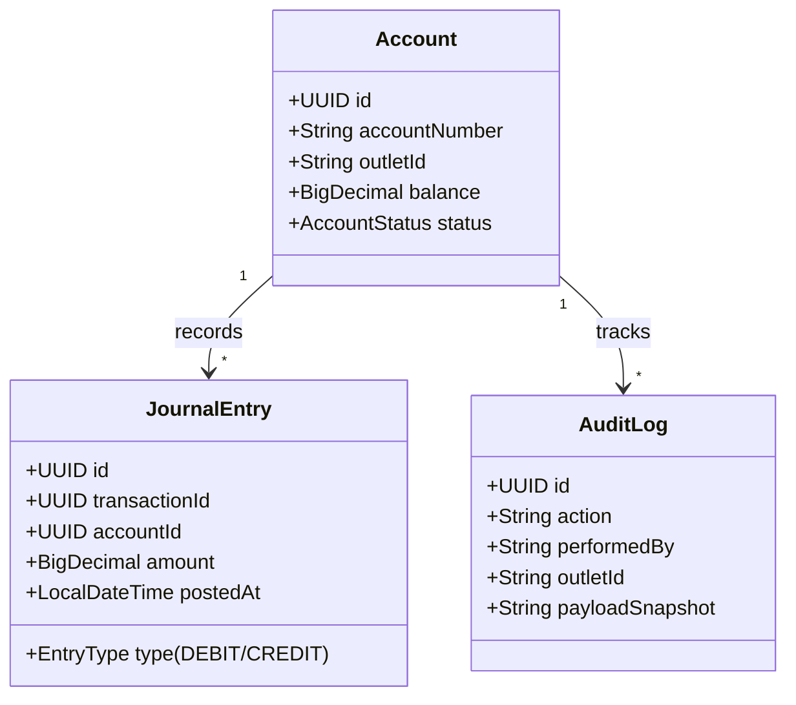

# Case Study 2: Core Banking Ledger Architecture & Multi-Tenant Boundaries

**Role Target:** Software Architect / Principal Backend Engineer  
**System:** `services/retail-finance` (Java 17 / Spring Boot 3 / MySQL 8 / Flyway / Python 3.11 Reconciliation)  
**Evidence Artifacts:**
- Outlet Authorization & Atomic Opening: `docs/evidence/retail-outlet-authorization-evidence.md`
- Testcontainers Verification: 30 integration tests pass against clean MySQL 8 container
- Codebase: `services/retail-finance/backend/src/main/java/com/mtaretail/core/`

---

## 1. Business Problem
In retail core banking and merchant finance:
1. **Financial Discrepancies & Orphan Records:** A failure midway through account creation (e.g., initial cash deposit failing after user insert) leaves orphan accounts or untracked cash on hand.
2. **Cross-Tenant Data Leakage:** In multi-outlet franchises, POS staff at Outlet A must never read, deposit to, or settle transactions for Outlet B—even if an attacker tampers with path parameters or replays signed JWT tokens.
3. **Database Schema Evolution:** Adding outlet isolation to existing ledgers without table locking or breaking legacy clients requires an expand-and-contract migration strategy.

---

## 2. Architectural Design & Invariants

### Invariant 1: Double-Entry Financial Consistency
- **Rule:** Every money movement must be an immutable debit and credit pair. The balance is a derived materialized projection of the journal entries.
- **Atomic Opening:** Account registration, initial `CASH_IN` ledger posting, and the regulatory audit entry are bound in a single Spring `@Transactional(isolation = Isolation.READ_COMMITTED)` boundary. If posting fails, the entire transaction rolls back; no partial accounts ever exist.

### Invariant 2: Strict Outlet Scoping & Negative Authorization
- **Domain Port:** `OutletAuthorizationService` checks tenant ownership at the service layer on every command and query, not merely role checking at the API gateway:
  - If a JWT contains `outletId: OUTLET-001`, any call targeting `OUTLET-002` (e.g., `/accounts/{accId}/transact`) is rejected with **HTTP 403 Forbidden** before acquiring database locks.
  - Stale JWTs or tampered claims cannot access or modify ledger rows.
  - Reconciliation service (`services/retail-finance/reconciliation-service`) reads multi-page feeds via keyset pagination without truncating discrepancies.

### Invariant 3: Multi-Tenant Schema Evolution (Flyway V2)
- Upgraded schema to introduce outlet partitioning (`V2__account_outlet_scope.sql`):
  1. Added nullable `outlet_id BIGINT NULL` column to `account`.
  2. Added index `idx_account_outlet (outlet_id)` for tenant query performance.
  3. Added foreign key constraint `fk_account_outlet` referencing `outlet(id)`.
  4. Preserved safety on legacy accounts: V1 accounts remain unassigned (`NULL`), denying POS operations until source-verified attribution rather than arbitrarily defaulting to the first outlet.
  5. *(Boundary Note: Non-locking zero-downtime execution requires online schema change tooling like pt-online-schema-change or gh-ost, which has not been benchmarked under live traffic).*

---

## 3. Empirical Verification Evidence

From `docs/evidence/retail-outlet-authorization-evidence.md`:
1. **Atomic Rollback:** Simulated crash during journal posting verified 0 accounts created, 0 balance mutated, and 0 audit leaks.
2. **Negative Authorization:**
   - User from `OUTLET-001` attempting transaction on `OUTLET-002` -> **HTTP 403 Forbidden**.
   - User attempting cross-outlet balance inquiry -> **HTTP 403 Forbidden**.
3. **Double-Entry Ledger Invariant:** Verified in `TransactionServiceIT`: Sum of debits exactly equals sum of credits across 1,000 synthetic transactions.

---

## 4. Architectural Defense for Interviews
- **Why MySQL 8 for Ledger vs. NoSQL?**
  "ACID compliance, serializable transactions for debit/credit balancing, and mature row locking. In a financial ledger, eventual consistency on account balances is unacceptable when overdrafts or credit limits are at stake."
- **How Do You Handle Migration Rollback?**
  "We employ the expand-and-contract pattern. New columns are nullable, code writes to both old and new representations, backfills occur online without exclusive table locks, and the deprecation contract is only tightened after 100% consumer adoption."
