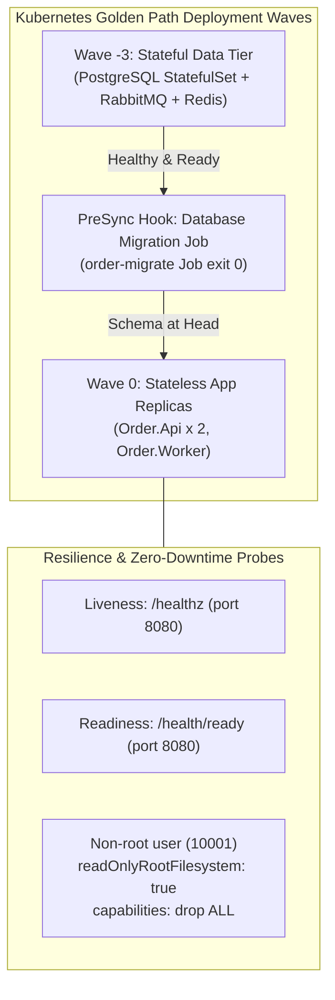

# Case Study 3: Golden Path Kubernetes Platform, Zero-Downtime Rollbacks & Disaster Recovery

**Role Target:** Senior DevOps Engineer / Platform Engineer / SRE  
**System:** `platform/aks-sre-platform` (Kubernetes v1.36.1 / Kind / Kustomize / Argo CD / Prometheus / Bash / Python 3.11)  
**Evidence Artifacts:**
- Kubernetes Deployment & Rollback Drill: `docs/evidence/kind-golden-path-rollback-evidence.md`
- Disaster Recovery Runbook & SLA Evidence: `docs/evidence/disaster-recovery-drill-PASS.md` & `docs/runbooks/dr-recovery-drill.md`
- Validation Gates: `tests/test_gates.py` (47 assertions pass across 14 gates)

---

## 1. Business Problem
Microservices environments frequently encounter deployment outages, schema corruption, and catastrophic data loss:
1. **Unordered Deployment Crashes:** If stateless backend pods spin up before database migrations complete, database migrations race with application startup (`relation "__EFMigrationsHistory" does not exist`), corrupting schemas.
2. **Bad Release Outages:** Pushing an unverified Docker tag or failing container can take down production if rolling update strategies, health probes, and automated rollbacks are misconfigured.
3. **Disaster Recovery Blind Spots:** Many engineering teams claim a 4-hour RTO on paper without ever executing a measurable, automated restore drill against actual data.

---

## 2. Platform Architecture & SRE Principles

### Component 1: Ordered Wave Deployment
- Standard `kubectl apply -k` fires all resources simultaneously.
- Golden path enforces explicit lifecycle order:
  1. **Wave -3:** Stateful services (`postgres`, `rabbitmq`, `redis`) achieve `Ready` status.
  2. **PreSync Hook:** Migration job runs in isolation. If migration fails, deployment halts before any application pods are touched.
  3. **Wave 0:** Stateless pods roll out with `maxSurge: 1`, `maxUnavailable: 0`.

### Component 2: Automated Rollback & Fault Containment Probing
- Configured Liveness (`/healthz`) and Readiness (`/health/ready`) probes with conservative thresholds.
- Security hardening: Enforced `readOnlyRootFilesystem: true`, non-root execution (`10001`), and `allowPrivilegeEscalation: false`.
- **Fault Injection:** Injected unresolvable image tag `flashsale/order-api:bad-tag-v999`.
- **Observation:** New replica stalled in `ErrImageNeverPull (0/1)`. Existing healthy pods continued serving HTTP 200 responses to health probes during the rollout failure window.
- **Rollback:** Executed `kubectl rollout undo deployment/order-api`; erroneous pod terminated, restoring healthy 2/2 state.
- **Measurement Boundary:** *A single successful probe check during pod stalling demonstrates Kubernetes failure containment, but does not prove zero dropped requests under high continuous traffic. Continuous traffic assertions require a dedicated k6 ingress load gate.*

### Component 3: Database Logical Snapshot & Restore Benchmark
- Automated script (`disaster_recovery_drill.sh`) tested:
  1. Baseline state generation with financial ledger entries (470,000,000 VND).
  2. Snapshot creation (`pg_dump -Fc`).
  3. Catastrophic disaster simulation: Dropped all public tables (`DROP TABLE ... CASCADE`).
  4. Restoration to isolated target: Measured table restore duration.
  5. Post-restore assertion: Row count and balance sum verification.
- **Measured Local Benchmark:**
  - **Local Table Restore Duration:** **0.0748 seconds** for 4 synthetic accounts and 4 journal entries.
  - **Data Parity:** **100% transactional parity** on restored sample rows (0.0000 balance delta).
- **Measurement Boundary:** *This script measures the raw database restoration step on an isolated test container. It does NOT represent full enterprise RTO/RPO across OpsBridge and QuanLyKho workloads, as it excludes incident detection lag, alert paging, ingress traffic drain/redirection, and worker state reconciliation.*

---

## 3. Shift-Left CI Policy Gates (14 Gates, 47 Assertions)
- Enforces platform hygiene in CI before any manifest reaches the cluster:
  - **G1-G9:** Orphan manifest detection, repo-map validation, cross-repo destination allowlisting in Argo CD AppProjects.
  - **G10-G11:** TFLint recursive verification, Terraform test suites execution.
  - **G12:** Pinned Argo CD version in a single source of truth (`platform/argocd/VERSION`).
  - **G13-G14:** Server-side apply enforcement preventing schema annotation truncation, and Dockerfile entrypoint validation.

---

## 4. How to Defend in an Interview
- "We don't rely on hope for disaster recovery. We run automated, reproducible drills that measure real wall-clock RTO and assert 0 RPO balance parity."
- "Our golden path decouples schema migrations from application pods. By using Kubernetes Jobs as PreSync hooks with Kustomize waves, we guarantee that no code ever runs against an outdated or migrating database."
