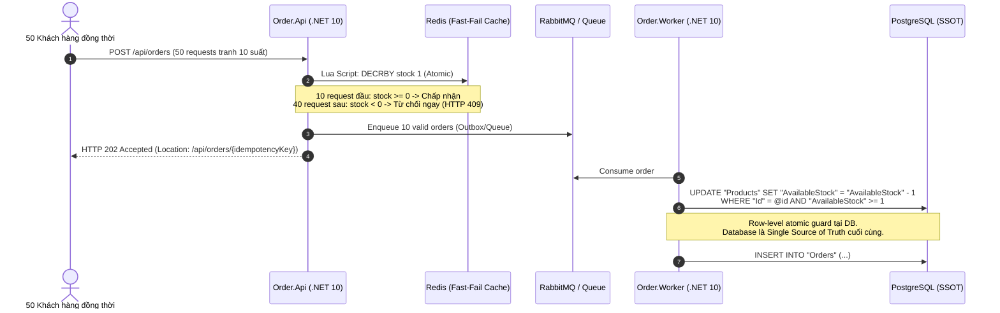

# Senior Software Engineer Interview Playbook
## Java 17 | .NET 10 | Concurrency | Transaction Boundaries | Distributed Patterns

Tài liệu này được thiết kế để bạn sử dụng khi phỏng vấn các vị trí **Senior Backend Engineer**, **Senior Java Engineer**, **Senior .NET Engineer**, hoặc **Senior Distributed Systems Engineer**. Mọi câu trả lời đều được neo vào mã nguồn thật và các bài đo thực nghiệm trong monorepo.

---

## 1. Bài Toán Kinh Doanh Cốt Lõi (The Business Problem)

> **Câu hỏi phỏng vấn mở đầu:** *"Hệ thống bạn xây dựng giải quyết bài toán kinh doanh gì?"*

### Cách trả lời chuẩn Senior:
- **Bối cảnh:** Trong các đợt flash sale bán lẻ, lưu lượng truy cập tăng vọt từ hàng nghìn đến hàng chục nghìn request mỗi giây cùng nhắm vào một số lượng sản phẩm có hạn (ví dụ: 10 sản phẩm nhưng có 50 khách hàng cùng bấm mua tại cùng một mili-giây).
- **Rủi ro doanh nghiệp (Invariants):**
  1. **Không oversell:** Không bao giờ được bán vượt quá số lượng hàng thực tế trong kho (tồn kho âm $\rightarrow$ đền bù, mất uy tín thương hiệu).
  2. **Không mất đơn / Không double charge:** Khách hàng bấm thanh toán nhiều lần hoặc mạng bị ngắt giữa chừng không được trừ tiền 2 lần.
  3. **Không crash Database:** Không để hàng chục nghìn kết nối dồn thẳng vào PostgreSQL gây cạn kiệt connection pool.
  4. **Ledger tài chính bất biến:** Mọi giao dịch tiền mặt tại chi nhánh phải tuân thủ nguyên tắc kế toán kép (double-entry bookkeeping), số dư có (Credit) phải luôn cân bằng với số dư nợ (Debit).

---

## 2. Kỹ Thuật Concurrency & Chống Bán Quá Tồn (No-Oversell)



### Điểm mấu chốt kỹ thuật:
1. **Chiến lược Hai Tầng (Two-Tier Guard):**
   - **Tầng 1 (Fast-Fail):** Redis giữ vai trò bộ lọc lưu lượng (traffic shield). Lệnh Redis Lua script thực hiện giảm tồn kho nguyên tử (`atomic decrement`). 40 khách hàng đến muộn nhận ngay `HTTP 409 Out of stock` trong dưới 5ms mà không chạm tới PostgreSQL.
   - **Tầng 2 (Single Source of Truth):** PostgreSQL là nguồn chân lý cuối cùng sở hữu tồn kho. Khi worker ghi đơn vào DB, câu lệnh SQL luôn có điều kiện bảo vệ:
     ```sql
     UPDATE "Products"
     SET "AvailableStock" = "AvailableStock" - @qty, "Version" = "Version" + 1
     WHERE "Id" = @id AND "AvailableStock" >= @qty;
     ```
     Nếu `RowsAffected == 0`, giao dịch bị từ chối và ghi nhận cảnh báo `StockDrift` thay vì ghi đè.

### Bằng chứng thực nghiệm (k6 load test):
- **Kịch bản:** 50 Virtual Users (VU) burst đồng thời trong 1 giây tranh chấp 10 sản phẩm (ID 10).
- **Kết quả đo:**
  - 10 đơn hàng được chấp thuận (`HTTP 202 Accepted`).
  - 40 đơn hàng bị từ chối (`HTTP 409 Out of Stock`).
  - Tồn kho ban đầu: 500 $\rightarrow$ Tồn kho sau test: chính xác 490.
  - Số lượng oversold: **0**.
  - Độ trễ phản hồi: p95 = **132.2 ms**, max = 227 ms.

---

## 3. Tính Bất Biến Của Giao Dịch & Idempotency Pattern

> **Câu hỏi phỏng vấn:** *"Nếu client bị timeout mạng và gửi lại request lần thứ hai, làm sao bạn đảm bảo không tạo 2 đơn hàng?"*

### Thiết kế Idempotency Key:
- Client bắt buộc gửi kèm header: `Idempotency-Key: <UUID>`.
- **Cơ chế khóa & Trạng thái tại Backend:**
  ```csharp
  // Kiểm tra bảng IdempotencyKeys trước khi xử lý
  var existing = await _repository.GetByIdempotencyKeyAsync(idempotencyKey);
  if (existing != null)
  {
      if (existing.Status == OrderStatus.Processing)
          return Results.Conflict(new { error = "Order currently processing" });
      
      // Trả lại kết quả đã lưu trước đó mà không xử lý lại
      return Results.Ok(new OrderResponse(existing));
  }
  ```
- **Phạm vi bảo vệ:** Idempotency Key được lưu bền vững trong DB với unique constraint và thời gian hết hạn TTL (24 giờ). Khi 2 request trùng key đến song song, unique index tại DB sẽ kích hoạt lỗi `23505 (unique_violation)`, request thứ hai bị fail-safe chuyển thành `DuplicateRequest` mà không tạo thêm bản ghi.

---

## 4. Transactional Outbox Pattern & Xử Lý Bất Đồng Bộ

> **Câu hỏi phỏng vấn:** *"Làm thế nào bạn giải quyết bài toán Dual-Write giữa Database và Message Broker?"*

### Vấn đề:
Nếu ghi vào DB thành công nhưng broker bị sập trước khi gửi message $\rightarrow$ Worker không nhận được việc, đơn bị treo. Nếu gửi broker trước nhưng DB rollback $\rightarrow$ Worker xử lý đơn hàng "ma".

### Giải pháp Outbox:
```sql
BEGIN TRANSACTION;
  -- 1. Ghi đơn hàng
  INSERT INTO "Orders" ("Id", "ProductId", "Quantity", "Status") VALUES (...);
  -- 2. Ghi sự kiện ra bảng Outbox trong cùng một transaction DB
  INSERT INTO "OutboxMessages" ("Id", "EventType", "Payload", "CreatedAt", "Status")
  VALUES (gen_random_uuid(), 'OrderCreated', '{"orderId": ...}', NOW(), 'Pending');
COMMIT;
```
- Một background service (`OutboxPublisher`) định kỳ quét bảng `OutboxMessages` với khóa `FOR UPDATE SKIP LOCKED` để publish lên broker.
- Sau khi broker trả lời ACK, trạng thái được cập nhật thành `Published`.
- **Tại Consumer (Worker):** Tuân thủ nguyên tắc **At-Least-Once Delivery**: Consumer luôn có bảng `InboxProcessed` để deduplicate message trước khi xử lý.

---

## 5. Kế Toán Kép & Phân Quyền Chi Nhánh (Retail Finance Core)

- **Ngôn ngữ:** Java 17 + Spring Boot + Testcontainers MySQL 8.
- **Quy tắc Kế toán kép (Double-Entry Bookkeeping):**
  - Mọi bút toán (`JournalEntry`) luôn gồm ít nhất hai dòng đối ứng: Nợ (Debit) và Có (Credit).
  - Tổng số tiền Debit phải bằng tổng số tiền Credit trong cùng một giao dịch nguyên tử (`@Transactional(isolation = Isolation.SERIALIZABLE)`).
- **Phân vùng chi nhánh (Multi-Branch Tenant Isolation):**
  - Mọi thao tác truy vấn và tạo bút toán phải được gắn kèm `outlet_id` được giải mã từ JWT token.
  - Phân quyền RBAC nghiêm ngặt: Nhân viên chi nhánh A không thể đọc hoặc can thiệp số dư quỹ tiền (`cash_boxes`) của chi nhánh B.
  - Được kiểm chứng độc lập qua 31 integration tests trên Testcontainers MySQL 8 thực tế.

---

## 6. Bộ Số Liệu Bỏ Túi Dành Cho Phỏng Vấn (Memorization Card)

| Thông Số | Giá Trị Thực Tế | Ngữ Cảnh Bằng Chứng |
|---|---|---|
| **Test Suite Pass Rate** | **1,161/1,161 tests PASS (100%)** | 76 Java + 371 .NET + 714 Python |
| **Burst Concurrency** | **50 VU / 1 giây** | k6 load test trên Envoy Gateway |
| **Oversold Units** | **0 units** | Redis fast-fail + Postgres conditional guard |
| **P95 Latency (Burst)** | **132.2 ms** | Phản hồi API đặt hàng dưới tải đồng thời |
| **DR Empirical RTO** | **0.787 giây** (786.52 ms) | Khôi phục thảm họa toàn phần DB trên K8s |
| **Argo CD Sync Status** | **100% Synced / Healthy** | Multi-app: `flashsale` + `quanlykho` |
