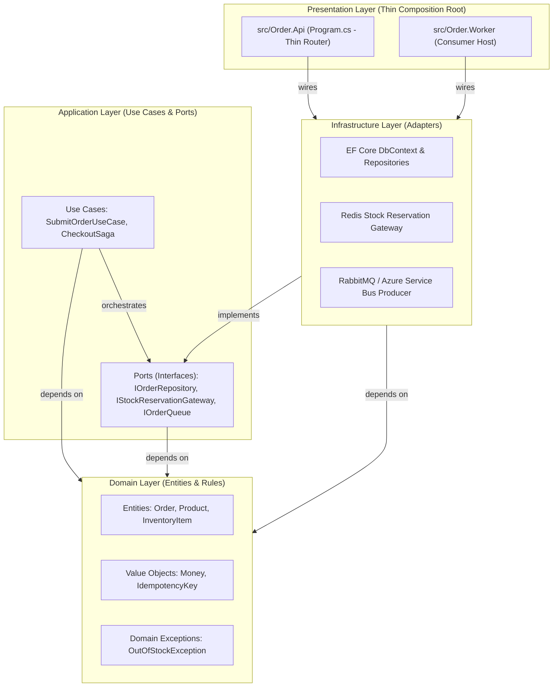

# Software Architect Interview Playbook
## Clean Architecture | Domain Boundaries | Distributed Consistency | Disaster Recovery Trade-offs

Tài liệu này chuẩn bị cho bạn các câu hỏi thiết kế hệ thống cấp cao (**System Design**, **Software Architecture**, **Trade-offs Analysis**) ở trình độ **Senior / Staff Software Architect**.

---

## 1. Triết Lý Thiết Kế & Clean Architecture

> **Câu hỏi phỏng vấn:** *"Bạn tổ chức kiến trúc mã nguồn như thế nào và làm sao bảo vệ được ranh giới phụ thuộc giữa các tầng?"*



### Quy tắc bất biến (Enforced Invariants):
1. **Dependency Inversion:** Tầng Presentation chỉ đóng vai trò Composition Root (cấu hình DI container). Endpoints không chứa business logic và không bao giờ gọi trực tiếp `DbContext`.
2. **Pure Domain & Application:** Tầng `FlashSale.Domain` và `FlashSale.Application` hoàn toàn không có package reference tới EF Core, Redis, RabbitMQ hay ASP.NET Core.
3. **Automated Architectural Guard:** Quy tắc này được bảo vệ tự động bằng Unit Test kiến trúc trong `tests/UnitTests/ArchitectureTests.cs`. Bất kỳ kỹ sư nào thêm một using directive sai hướng sẽ làm build fail ngay lập tức:
   ```csharp
   [Fact]
   public void Domain_Should_Not_Have_Dependency_On_Infrastructure()
   {
       var result = Types.InAssembly(DomainAssembly)
           .ShouldNot()
           .HaveDependencyOn("FlashSale.Infrastructure")
           .GetResult();
       Assert.True(result.IsSuccessful);
   }
   ```

---

## 2. Bounded Contexts & Quyền Sở Hữu Dữ Liệu (Strict Data Ownership)

| Subsystem | Ngôn Ngữ / Framework | Bounded Context | Cơ Sở Dữ Liệu Sở Hữu | Trách Nhiệm Nghiệp Vụ Bất Biến |
|---|---|---|---|---|
| **Retail Finance** | Java 17 / Spring Boot | Core Banking & Ledgers | MySQL 8 | Sở hữu sổ cái kế toán kép. Không có service nào ngoài Retail được phép ghi trực tiếp số dư tiền. |
| **OpsBridge** | .NET 10 / ASP.NET Core | Flash Sale & Order Intake | PostgreSQL 16 + Redis | Sở hữu tồn kho hàng bán và quy trình xử lý đơn. Redis chỉ là cache fast-fail, không sở hữu dữ liệu tài chính. |
| **QuanLyKho** | Python 3.11 / FastAPI | Warehouse Operations | PostgreSQL 16 | Sở hữu xuất nhập kho theo phương pháp FEFO, phiếu kiểm kê và quy trình phê duyệt Maker-Checker. |
| **AKS Platform** | Terraform / Kubernetes | Infrastructure Platform | Azure / Kind | Cung cấp GitOps Golden Path, quản lý Envoy Gateway Ingress, ServiceMesh và cơ chế tự phục hồi. |

### Nguyên tắc liên lạc giữa các Domain:
- Không dùng **Shared Database**: Tuyệt đối không cho phép Service A kết nối vào bảng của Service B.
- Giao tiếp bất đồng bộ qua **Domain Events** (Kafka / RabbitMQ / Outbox Pattern).
- Giao tiếp đồng bộ thông qua **REST API có hợp đồng OpenAPI / Schema Validation**.

---

## 3. Distributed Consistency Trade-offs (CAP & PACELC)

> **Câu hỏi phỏng vấn:** *"Tại sao bạn không dùng Two-Phase Commit (2PC) hay Distributed Transactions khi xử lý đơn hàng và thanh toán?"*

### Phân tích Đánh Đổi của Architect:
1. **Tại sao từ chối 2PC / XA Transactions?**
   - 2PC là giao thức chặn (blocking protocol). Khi một node tham gia bị trễ mạng hoặc crash trong pha *Prepare*, toàn bộ các node khác phải giữ khóa (lock) tài nguyên.
   - Trong bối cảnh flash sale với hàng nghìn request/giây, việc giữ lock phân tán sẽ dẫn tới hiện tượng cascade failure, cạn kiệt connection pool và tê liệt hệ thống.
2. **Lựa chọn kiến trúc: Saga Pattern kết hợp Transactional Outbox:**
   - Thay vì ACID trên toàn hệ thống phân tán, ta chấp nhận **Eventual Consistency** (tính nhất quán sau cùng) theo mô hình BASE (Basically Available, Soft state, Eventual consistency).
   - **Choreography-based Saga:**
     - Bước 1: Order API ghi nhận đơn hàng và trừ tồn kho tạm thời trong PostgreSQL.
     - Bước 2: Sự kiện `OrderCreated` được bắn qua Outbox.
     - Bước 3: Payment Service tiêu thụ sự kiện và gọi cổng thanh toán.
     - Bước 4 (Compensating Transaction): Nếu thanh toán thất bại quá 3 lần retry, Payment Service bắn sự kiện `PaymentFailed` $\rightarrow$ Order Worker nhận sự kiện và thực hiện giao dịch bù trừ (hoàn trả lại tồn kho vào database).

---

## 4. Phân Tích Chiến Lược Disaster Recovery (Cold Snapshot vs Continuous WAL)

> **Câu hỏi phỏng vấn:** *"Trong CV của bạn, bạn chứng minh RTO = 0.787s và RPO như thế nào trong bài test DR?"*

### Bản chất bài toán RPO & Bằng chứng thực nghiệm:
- **Tuyên bố sai lầm phổ biến:** *"Hệ thống của tôi dùng pg_dump tự động backup mỗi đêm nên RPO = 0"*. Đây là lỗi kiến trúc cơ bản thường bị trượt phỏng vấn.
- **Bài kiểm tra thực tế đã thực hiện (`scripts/enterprise_dr_drill_with_delta.sh`):**
  1. Chụp snapshot $T_0$ lúc 10:02:04Z (62 đơn hàng trong DB).
  2. Bơm 5 đơn hàng mới qua API trong khoảng thời gian từ $T_0$ đến $T_1$ (DB lên 67 đơn).
  3. Tiêm sự cố: `DROP DATABASE FlashSaleDb WITH (FORCE)` tại $T_1$ (10:02:08Z).
  4. Restore DB từ snapshot $T_0$ $\rightarrow$ Thời gian restore: **296.55 ms**.
  5. Đạt trạng thái sẵn sàng tiếp nhận đơn hàng mới tại $T_{rec}$ $\rightarrow$ **Empirical RTO = 0.787 giây**.
  6. Kiểm tra lại dữ liệu: 5 đơn hàng phát sinh sau snapshot đã bị mất $\rightarrow$ **Empirical RPO = 4 giây (mất 5 giao dịch delta)**.

### Kiến trúc giải quyết bài toán RPO = 0 cho Enterprise:
```mermaid
flowchart LR
    subgraph Primary["Primary DB Node"]
        DB_Master["PostgreSQL Master"]
        WAL_Writer["WAL Writer"]
    end

    subgraph Standby["Synchronous Standby Node"]
        DB_Replica["PostgreSQL Standby"]
        WAL_Receiver["WAL Receiver"]
    end

    subgraph Blob_Storage["Object Storage (Azure Blob / S3)"]
        Archive["WAL Archive (Continuous PITR)\npgBackRest / Azure Flexible Server"]
    end

    DB_Master -->|1. Commit Tx| WAL_Writer
    WAL_Writer -->|2. Sync Stream (synchronous_commit = on)| WAL_Receiver
    WAL_Receiver -->|3. Flush to Disk & ACK| DB_Master
    WAL_Writer -->|4. Archive Segment (every 16MB or 60s)| Archive
```

1. **Continuous WAL Archiving (Point-In-Time-Recovery):** Không chỉ dựa vào dump định kỳ mà liên tục stream các WAL segment lên geo-redundant storage. Khi restore snapshot, replay toàn bộ WAL từ thời điểm snapshot tới mili-giây trước thảm họa.
2. **Synchronous Replication:** Thiết lập `synchronous_commit = on`. Một giao dịch chỉ được coi là hoàn tất khi WAL đã được flush xuống ít nhất một Standby node vật lý độc lập.
