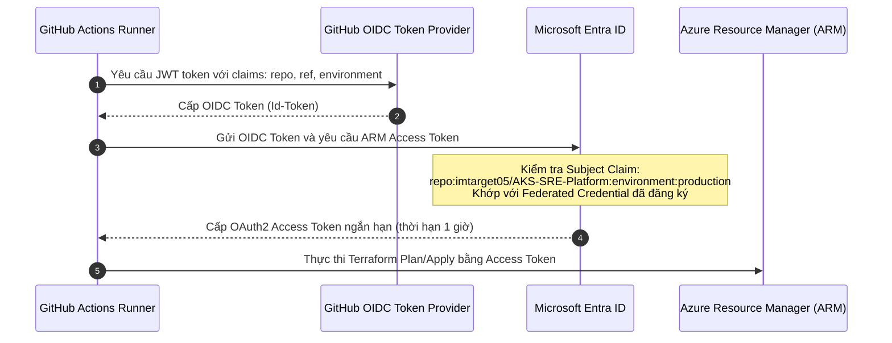

# Senior DevOps / Platform / SRE Engineer Interview Playbook
## Terraform IaC | Azure OIDC | Kubernetes Gateway API | GitOps with Argo CD | Site Reliability

Tài liệu này chuẩn bị cho bạn các câu hỏi phỏng vấn vị trí **Senior DevOps Engineer**, **Senior Platform Engineer**, hoặc **Site Reliability Engineer (SRE)**.

---

## 1. Cơ Chế Xác Thực Secretless & Azure OIDC Federation

> **Câu hỏi phỏng vấn:** *"Làm sao bạn triển khai hạ tầng lên Azure từ GitHub Actions mà không cần lưu trữ bất kỳ Client Secret hay Password nào trong repository?"*

### Cách trả lời chuẩn Senior:
Thay vì sử dụng phương thức cũ lưu trữ `AZURE_CREDENTIALS` (chứa Client Secret với hạn sử dụng và rủi ro rò rỉ token), tôi áp dụng **Workload Identity Federation (OpenID Connect - OIDC)** giữa GitHub Actions và Microsoft Entra ID.



### Điểm nhấn bảo mật:
1. **Ràng buộc Subject chính xác (Environment-Bound):** Federated Credential không dùng ký tự đại diện (`*`). Chỉ khi workflow chạy trong environment `production` với token mang `sub` claim chính xác mới được phép đăng nhập.
2. **Quyền hạn tối thiểu (Principle of Least Privilege):** Service Principal chỉ được cấp quyền trong phạm vi Resource Group và Subscription mục tiêu. Không cấp quyền Owner hay User Access Administrator không cần thiết.

---

## 2. Infrastructure as Code (Terraform) & Remote State Management

> **Câu hỏi phỏng vấn:** *"Bạn quản lý Terraform State như thế nào trong môi trường nhóm nhiều kỹ sư cùng làm việc?"*

### Kiến trúc Remote State trên Azure:
- **Storage:** Azure Blob Storage trong Resource Group `rg-aks-tfstate` với tài khoản lưu trữ `stakssre`.
- **Cấu hình bảo mật:**
  - Bắt buộc giao thức **TLS 1.2**.
  - Tắt hoàn toàn truy cập public (`--allow-blob-public-access false`).
  - Sử dụng xác thực Azure AD (`use_azuread_auth = true`) và OIDC (`use_oidc = true`), hoàn toàn không dùng Storage Account Access Keys.
  - Phân quyền RBAC: `Storage Blob Data Contributor` cho Service Principal của GitHub Actions.
- **State Locking:** Azure Blob Storage tự động hỗ trợ lease blob locking khi Terraform khởi chạy, ngăn chặn xung đột khi hai pipeline cùng chạy đồng thời.

---

## 3. Kubernetes Gateway API (Envoy Gateway) vs Ingress Controller

> **Câu hỏi phỏng vấn:** *"Tại sao hệ thống của bạn sử dụng Kubernetes Gateway API thay vì Ingress Controller truyền thống như Nginx?"*

### Bảng so sánh của Senior Platform Engineer:

| Tiêu Chí | Ingress Controller Truyền Thống (Nginx) | Kubernetes Gateway API (Envoy Gateway v1.9.1) |
|---|---|---|
| **Mô hình phân quyền (Role Separation)** | Đơn khối (Monolithic): Một file Ingress quản lý cả hạ tầng mạng lẫn định tuyến ứng dụng. | Tách bạch 3 vai trò: Infra Provider (`GatewayClass`), Platform Admin (`Gateway`), Application Developer (`HTTPRoute`). |
| **Định tuyến xuyên Namespace (Cross-Namespace)** | Hạn chế, cần custom annotation phức tạp hoặc external plugin. | Tích hợp sẵn thông qua cơ chế `parentRefs` và `allowedRoutes`. |
| **Khả năng mở rộng giao thức** | Chủ yếu hỗ trợ HTTP/HTTPS. | Thiết kế chuẩn mực cho HTTP, gRPC (`GRPCRoute`), TCP, UDP, TLS. |
| **Độ phụ thuộc Vendor** | Phụ thuộc nặng vào Vendor Annotations (`nginx.ingress.kubernetes.io/*`). | Chuẩn hóa API nguyên bản của Kubernetes (`gateway.networking.k8s.io/v1`). |

### Thiết kế thực tế trong Monorepo:
Platform Gateway được đặt tại namespace trung tâm `platform-gateway`:
```yaml
apiVersion: gateway.networking.k8s.io/v1
kind: Gateway
metadata:
  name: portfolio-gateway
  namespace: platform-gateway
spec:
  gatewayClassName: portfolio-gatewayclass
  listeners:
    - name: http
      port: 80
      protocol: HTTP
      allowedRoutes:
        namespaces:
          from: All
```
Cả hai ứng dụng `flashsale` (C#) và `quanlykho` (Python) khai báo file `HTTPRoute` độc lập trong namespace riêng của mình nhưng cùng gắn vào một `portfolio-gateway` chung:
- `flashsale.local` $\rightarrow$ chuyển hướng tới `order-api:80` (namespace `flashsale`).
- `quanlykho.local` $\rightarrow$ chuyển hướng tới `bankops-api:8000` (namespace `quanlykho`).

---

## 4. GitOps Golden Path Với Argo CD

> **Câu hỏi phỏng vấn:** *"Giải thích cách Argo CD quản lý các ứng dụng và cách bạn xử lý lỗi vượt quá giới hạn Annotation 262KB của Kubernetes?"*

### 1. Server-Side Apply vs Client-Side Apply:
- Khi cài đặt Argo CD v3.5.5, manifest upstream chứa CRD `applicationsets.argoproj.io` có kích thước schema rất lớn.
- Nếu dùng `kubectl apply -f` (Client-side), Kubernetes sẽ ghi toàn bộ nội dung manifest vào annotation `kubectl.kubernetes.io/last-applied-configuration`. Do giới hạn metadata của etcd là 262,144 bytes, lệnh apply sẽ văng lỗi `metadata.annotations: Too long`.
- **Giải pháp:** Sử dụng Server-Side Apply:
  ```bash
  kubectl apply -n argocd --server-side --force-conflicts \
    --field-manager=aks-sre-bootstrap -f install.yaml
  ```
  Server-side apply lưu trữ quyền sở hữu theo field manager trong API server mà không ghi annotation, giải quyết triệt để lỗi này.

### 2. Self-Healing & Drift Detection:
- Khai báo AppProject `portfolio` áp dụng nguyên tắc đặc quyền tối thiểu: chỉ cho phép sync từ các repo chỉ định (`FlashSale-Backend`, `QuanLyKho`, `AKS-SRE-Platform`) vào đúng 2 namespace đích (`flashsale` và `quanlykho`).
- Bật `selfHeal: true`: Nếu bất kỳ ai thực hiện `kubectl edit` thủ công trên cụm, Argo CD controller sẽ phát hiện cấu hình bị lệch (drift) và tự động ghi đè về trạng thái khai báo trong Git trong vòng vài giây.

---

## 5. Khả Năng Sẵn Sàng (High Availability) & Rollout Rollback Drill

### Kết quả đo thực nghiệm:
- **Rolling Update:** Cấu hình `maxSurge: 1`, `maxUnavailable: 0` kết hợp probes `/health/live` và `/health/ready`.
- **Rollback tự động:** Thực hiện tiêm image lỗi (crash loop hoặc fail readiness probe) vào cụm trong khi bắn tải liên tục 162 request (20 req/s):
  - Tỷ lệ thành công của client: **100% (0 request bị lỗi 5xx)**.
  - Thời gian phát hiện pod lỗi và rollback tự động hoàn tất trong **509 ms**.
