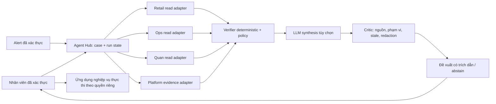

# Kế hoạch bàn giao Antigravity: một hệ multi-agent phục vụ bốn repo

**Trạng thái:** DESIGN ONLY, chưa triển khai. **Ngày lập:** 2026-10-24. **Mục tiêu:** xây một hệ điều phối agent giúp nhân viên điều tra ngoại lệ tài chính, đơn hàng, kho và sự cố nền tảng nhanh hơn, với chứng cứ kiểm tra được. Không dùng LLM để quyết định ghi tiền, bán hàng, duyệt kho hoặc thay đổi hạ tầng.

## 1. Bài toán doanh nghiệp và tiêu chí thành công

Một sự cố thực tế thường nằm rải rác ở nhiều nguồn: bản ghi canonical, hàng đợi, log, cảnh báo và runbook. Nhân viên phải tự ghép timeline, xác định dữ liệu nào đáng tin, tìm quy trình xử lý và bàn giao cho đúng người. Hệ này tạo **hồ sơ điều tra có nguồn, phiên bản và người chịu trách nhiệm**; nó không thay thế transaction engine hay quy trình phê duyệt.

| Nghiệp vụ | Người sử dụng | Câu hỏi cần trả lời | Giá trị cần đo trong pilot synthetic/shadow |
| --- | --- | --- | --- |
| Retail Finance | Nhân viên đối soát/OPS | Một giao dịch thiếu, trùng hoặc lệch tiền nằm ở nguồn nào; cần ai xác minh? | Thời gian tìm nguyên nhân; tỷ lệ case phân loại đúng; không bỏ sót case rủi ro cao. |
| OpsBridge/FlashSale | SRE và nhân viên vận hành đơn/đối soát | Đơn/reservation/outbox/queue đang ở trạng thái nào sau retry, worker crash hoặc broker outage? | Thời gian dựng timeline; số orphan reservation phát hiện; không kết luận “đã bán” khi DB chưa xác nhận. |
| QuanLyKho | Checker theo chi nhánh | Phiếu điều chỉnh/kiểm kê có chênh lệch, FEFO hoặc quyền truy cập bất thường nào cần xem trước khi duyệt? | Thời gian kiểm tra phiếu; false negative của rủi ro cao; tỷ lệ trích dẫn SOP đúng; không lộ dữ liệu chi nhánh khác. |
| AKS-SRE-Platform | On-call/SRE | Alert liên quan workload, rollout hay hạ tầng; runbook và bước xác minh nào phù hợp? | Alert-to-triage time; tỷ lệ định tuyến runbook đúng; số đề xuất nguy hiểm bị chặn; thời gian xác nhận resolve. |

**Không có claim production** khi mới chạy local/Kind hoặc với dữ liệu synthetic. Chỉ nói giá trị đạt được sau khi đo trước/sau trên cùng case, workload và môi trường. Target định lượng được khóa sau khi thu baseline ở Phase 0; không tự điền các số đẹp vào CV.

## 2. Phase 0 — Khảo sát tài liệu, chụp trạng thái và thiết kế ca đánh giá

Antigravity bắt đầu bằng việc đọc `AGENTS.md`, `PHASES.md`, `STATUS.md`, AGENTS/ADR của từng repo và các file trong bảng dưới. Chụp branch, HEAD, remote main, trạng thái working tree, PR và CI exact SHA. `STATUS.md` là snapshot: hiện `AGENTS.md` còn ghi cặp active Retail + Ops, trong khi `STATUS.md` ghi Quan + AKS đang làm; có WIP ở `STATUS.md`, ba CV và Quan overlay. Xác định owner WIP và cặp active trước khi sửa; không ghi đè phần việc người khác.

### API/pattern đã xác nhận và được phép dùng làm điểm xuất phát

| Repo | Nguồn hiện hữu, file tham chiếu | Ranh giới |
| --- | --- | --- |
| Retail | `services/retail-finance/reconciliation-service/app/triage.py` có `EvidenceAgent` → `RiskAgent` → `ActionAgent` deterministic; `app/main.py` có `POST /api/v1/reconcile`, đọc Java `GET /api/v1/transactions/settled` tại `backend/src/main/java/com/mtaretail/core/web/TransactionController.java`. | MySQL ledger là nguồn sự thật. Endpoint đối soát hiện dùng bearer token cấu hình chung, **chưa phải quyền agent theo outlet**. Giữ reconcile/triage đọc dữ liệu; không tạo agent tool post ledger. |
| Ops | `src/OpsBridge.Api/Endpoints/ReconciliationEndpoints.cs` có GET result/discrepancies/batches/audit-trail; `src/Order.Api/Program.cs` có GET outbox pending/stuck; `src/OpsBridge.Api/Auth/OpsBridgeAuthPolicies.cs` phân quyền AuditorOrAbove và Review. | GET theo quyền là nguồn đầu vào. `POST /reconciliation/run`, `/discrepancies/{id}/review`, `/api/outbox/requeue` **không được đăng ký làm agent tool**. PostgreSQL sở hữu order/stock. |
| Quan | `backend/app/api/routes/ai.py` có `POST /api/v1/ai/assess-request`, lấy phiếu canonical và kiểm tra location; `backend/app/services/ai.py` đặt deterministic risk floor; `backend/app/api/routes/inventory.py` giữ maker–checker và audit/outbox transaction. | Agent chỉ đưa thông tin cho checker; không gọi approve/post. Quyền chi nhánh phải được kiểm tra tại service sở hữu dữ liệu. |
| AKS | `scripts/aiops_incident_triage.py` có `IncidentTriageEngine.triage(alert_query: str)` tìm runbook bằng từ khóa; `platform/observability/local-platform-prometheusrule.yaml` có alert local; `platform/argocd/applications/` có mẫu Application. | Script hiện chỉ đọc file/CLI, chưa có receiver hay run store. Không thực thi `recommended_actions` lấy từ Markdown. AKS sở hữu deploy/identity/telemetry, không sở hữu logic nghiệp vụ. |

**Anti-pattern đã thấy cần khóa trước khi mở AI thật:** Ops copilot tại `src/OpsBridge.Web/src/components/ai/OpsCopilotWidget.tsx` lưu Gemini key trong `localStorage`, gọi provider trực tiếp từ browser và có số hóa đơn hardcode; Quan cho client chọn `provider` trong chat, rate limit in-memory, trace có thể chứa prompt/answer, eval 24 câu chỉ đo retrieval và runner luôn exit 0; AKS local stack đang tắt Alertmanager, Langfuse chỉ là manifest tùy chọn; Retail bearer token chung chưa chứng minh outlet scope. Kiểm tra code và config hiện thời một lần nữa trước khi sửa vì các path này có thể thay đổi.

**Output Phase 0:** `docs/adr/` cho ranh giới Hub/domain/platform; threat model và data-flow; OpenAPI/tool contract DRAFT; danh sách 12–16 case thật về nghiệp vụ nhưng dùng dữ liệu synthetic đã khử PII; baseline thời gian điều tra thủ công; bảng owner, cặp active và trạng thái Git/CI. Mỗi case ghi input, trạng thái DB/queue trước-sau, nguồn kỳ vọng, câu trả lời chấp nhận, quyền người dùng, hành động bị cấm và điều kiện phải abstain. Casebook là bộ ca nhỏ nhưng có thể phân biệt quyết định đúng/sai, không phải hàng trăm test lặp implementation.

**Gate:** owner xác nhận được, không có WIP bị ghi đè, contract đi đúng API đang tồn tại hoặc đánh dấu rõ `NEW`, baseline và ca RED trước khi code. Nếu Gate 3/4 release path chưa hoàn tất, AI chỉ triển khai trong môi trường cô lập; không claim golden path/cloud.

## 3. Kiến trúc đích

Đặt **Agent Hub** như một module/service dùng chung trong monorepo (`services/agent-hub/`, tên/path chỉ là đề xuất), không tạo repo thứ năm để trưng bày. Hub sở hữu intake, điều phối, state của run, allowlist tool, redaction, model adapter, evidence/proposal/audit và eval. Mỗi workload sở hữu adapter/API đọc có quyền và policy nghiệp vụ của mình. AKS sở hữu identity, secrets, deploy, telemetry, policy và runbook. Hub dùng DB riêng cho run/evidence; tuyệt đối không đọc DB nghiệp vụ trực tiếp, không ghi chéo DB.

**Một run có các trạng thái:** `received → authorized → evidence_collected → policy_checked → drafted → verified → proposed/abstained → human_decision_recorded → closed`. Chuyển trạng thái bền vững, có idempotency key, timeout, retry có giới hạn và sự kiện audit. Crash/replay không tạo hai proposal có hiệu lực cho cùng case/version. Human action diễn ra trong ứng dụng nghiệp vụ hiện có, sau đó Hub chỉ đọc để xác minh kết quả.

**Vai trò agent runtime, không nhân bốn bản sao:**

1. `Router`: xác thực case type, user/service identity, outlet/branch và quyền tối thiểu; từ chối cross-scope trước khi gọi tool.
2. `Evidence collectors`: chạy song song các GET được allowlist, bounded pagination/time window; trả fact có source ID, record version, thời gian và hash. Không đọc raw DB, log không giới hạn hay web tùy ý.
3. `Domain verifier`: kiểm tra invariant deterministic (tiền đối soát exact amount/reference; order/stock từ PG; risk floor maker–checker; trạng thái alert/rollout). Kết luận này không do LLM thay thế.
4. `Synthesis agent`: tùy chọn dùng LLM server-side để tóm tắt timeline, nêu giả thuyết và bước xác minh. Không tự tạo fact; mỗi mệnh đề phải trỏ nguồn.
5. `Critic/guard`: xác minh citation, freshness, scope, redaction, contradiction, output schema; thiếu nguồn hoặc tool lỗi thì `abstain`/heuristic fallback.
6. `Human reviewer`: người có đúng vai trò chấp nhận hoặc bác đề xuất và ghi lý do. Reviewer không trao quyền ghi cho Hub.

`EvidenceEnvelope` **mới, cần thiết kế/đóng schema ở Phase 0**: `case_type`, `entity_ref`, `source_service`, `source_sha`, `scope_id`, `record_version`, `observed_at`, `expires_at`, `facts`, `source_refs`, `classification`, `redaction_level`, `evidence_hash`. `Proposal` **mới**: `run_id`, `case_version`, `summary`, `hypotheses[]`, `citations[]`, `unknowns[]`, `severity`, `suggested_owner`, `suggested_read_only_checks[]`, `abstained`, `model_or_rule_version`, `cost`. Không cho model tạo executable command/script; runbook chỉ trỏ tới tài liệu và mục tiêu xác minh.

**Ca xuyên repo chứng minh lý do có một Hub:** alert tỷ lệ đơn lỗi ở AKS kích hoạt case Ops; Hub đọc alert/rollout và order/outbox qua hai adapter, dựng một timeline có SHA/image/record ID, đề xuất on-call kiểm tra worker hoặc broker. SRE quyết định rollback trong quy trình platform riêng; nhân viên Ops quyết định xử lý order trong ứng dụng riêng. Nếu không thể chứng minh correlation này giảm thời gian điều tra so với dashboard/runbook hiện có, không phát triển thêm agent chéo repo. Retail và Quan vẫn là case riêng, chia sẻ control plane/eval chứ không chia sẻ dữ liệu nghiệp vụ cho nhau.

**Không thêm broker/cache vì tên công nghệ:** giai đoạn đầu dùng PostgreSQL của Hub cho run state và durable work queue/outbox, nếu thiết kế cần async. RabbitMQ/Kafka chỉ được đề xuất qua ADR khi có consumer, ordering/replay/failure model và bằng chứng throughput/latency; Redis chỉ khi đo cho thấy shared rate limit/cache cần thiết. Broker/cache không là nguồn sự thật cho ledger, order hay tồn kho.

## 4. Phase 1 — Hub + Retail Finance: đối soát có chứng cứ

**Vấn đề:** một đối soát thiếu/trùng/lệch số tiền cần phân biệt lỗi nguồn đối tác, lỗi ingest và giao dịch đã settled. **Invariant:** agent không ghi ledger, không diễn giải sai amount/reference, không đọc ngoài outlet được cấp quyền. **Owner sửa:** Hub core và Retail recon/backend auth/read contract; tối đa hai thành phần active.

**Làm:** tái sử dụng logic deterministic tại `reconciliation-service/app/triage.py` và matching `app/reconciler.py`; đóng case đầu tiên bằng partner CSV synthetic + settled feed. Thêm identity/scope cho agent call thay bearer token chung nếu dùng dữ liệu phân outlet. Ghi immutable evidence, proposal, nguồn và quyết định của nhân viên. LLM chỉ giải thích discrepancy đã được code tính; timeout thì trả báo cáo deterministic. Nếu định thêm endpoint, viết OpenAPI và test quyền trước; không suy đoán chữ ký API mới.

**RED trước sửa:** cùng giao dịch gửi lặp, sai amount, feed phân trang lỗi/truncated, outlet khác và crash sau lưu evidence. **Gate:** đối chiếu với DB MySQL thật/Testcontainers; các case có verdict đúng, 0 cross-outlet read, 0 ledger write từ identity của Hub, retry cho cùng key không sinh kết luận trùng, report vẫn dùng được khi model tắt. Lưu elapsed time của analyst trên casebook để so trước/sau; không dùng số test pass thay cho hiệu quả điều tra.

**Anti-pattern:** không đưa Kafka vào chỉ để phát sự kiện; không để LLM sửa khoản tiền hoặc hạ mức rủi ro; không gọi REST bằng token Ops toàn cục trong production pilot. **Claim sau Gate:** “AI hỗ trợ giải thích đối soát trên feed có nguồn và kiểm soát quyền”; chưa nói “tự xử lý giao dịch”.

## 5. Phase 2 — Hub + OpsBridge/FlashSale: điều tra đơn và queue

**Vấn đề:** khi broker/worker lỗi, vận hành cần biết đơn bền vững hay reservation treo, đồng thời đối soát nhà cung cấp không bị trình bày thành invoice giả. **Invariant:** PostgreSQL quyết định stock/order; message at-least-once có thể lặp; agent không requeue/reconcile/review. **Owner sửa:** Hub adapter và Ops API/web. Sau khi Phase 1 đóng gate, chỉ Hub + Ops active.

**Làm:** copy pattern quyền `AuditorOrAbove` ở `OpsBridgeAuthPolicies.cs` và dùng GET result/discrepancies/batches/audit-trail trong `ReconciliationEndpoints.cs`; dùng GET outbox pending/stuck trong `Order.Api/Program.cs`. Nếu thiếu read endpoint cho timeline order/reservation, tạo endpoint chỉ đọc theo contract versioned và test quyền. Thay `OpsCopilotWidget.tsx` bằng UI nhận proposal từ backend, bỏ `localStorage` key, provider call browser và hóa đơn hardcode. Phân biệt rõ `AiAutomationService` hiện trả `IsSimulated=true`; không biến heuristic EOQ thành dự báo production.

**RED trước sửa:** queue reject sau reserve, mất ACK, worker crash sau DB commit, duplicate delivery, outbox stuck, discrepancy ID không tồn tại, user Auditor cố gọi mutation. **Gate:** trên DB/broker cô lập, agent dựng đúng timeline và chỉ ra record ID cho các failure mode; 0 sai lệch invariant 50 người/10 suất (10 accepted durable, 40 rejected, tồn cuối 0) theo test nghiệp vụ; 0 tool mutation; UI không gửi dữ liệu/key cho model từ browser; đo thời gian tìm root cause và false-safe. **Anti-pattern:** không thêm Kafka vào cùng luồng chỉ để có “multi-broker”, không đưa LLM vào path nhận đơn. **Claim:** “hỗ trợ điều tra failure/retry của đơn với evidence”; không claim agent tự khôi phục order.

## 6. Phase 3 — Hub + QuanLyKho: trợ lý checker theo phiếu canonical

**Vấn đề:** checker cần xem chênh lệch kiểm kê, FEFO, lô và lịch sử phiếu trước khi duyệt. **Invariant:** maker ≠ checker, approval/audit/outbox vẫn trong transaction hiện hữu; mức cảnh báo deterministic không bị model giảm; không lộ dữ liệu chi nhánh khác. **Owner sửa:** Hub adapter và Quan backend/UI. Chỉ bắt đầu sau khi Phase 2 đóng gate, giữ hai thành phần active.

**Làm:** copy pattern nạp phiếu canonical và kiểm tra location từ `backend/app/api/routes/ai.py` (`POST /api/v1/ai/assess-request`); giữ `backend/app/services/ai.py` làm policy floor. Thêm discrepancy investigator read-only gom phiếu, lô/FEFO, stocktake và SOP theo scope; output gắn voucher ID/version và citation. Trước khi mở provider, bỏ quyền client chọn `provider`, định chính sách server-side theo môi trường, redaction prompt/trace, rate limit dùng state chia sẻ nếu pilot nhiều replica. Approval vẫn chỉ đi qua route `inventory.py` của người có quyền.

**RED trước sửa:** phiếu bị đổi version sau khi evidence thu thập; cross-branch ID; maker tự duyệt; SOP chứa prompt injection; provider timeout/trả risk thấp; trace chứa thông tin nhạy cảm. **Gate:** cross-branch luôn 404/deny, stale voucher buộc refresh/abstain, policy floor không giảm, 0 approve/post từ Hub, checker nhìn được nguồn và unknowns, đo thời gian điều tra/false negative trên casebook. Sửa `scripts/run_ai_eval.py` để exit nonzero khi fail threshold đã duyệt; chấm generated answer/citation thật chứ không chỉ tên file được retrieval. Chưa dùng điểm synthetic training để quảng bá “ML tốt”; MLflow promotion thiếu R² phải fail closed nếu đưa vào pipeline case này.

**Anti-pattern:** không tin payload phiếu do client tự khai, không cho AI thay checker, không coi Langfuse trace là bằng chứng chính xác. **Claim:** “trợ lý điều tra phiếu kho có giới hạn chi nhánh và quyền checker”; chưa nói tự động duyệt hoặc dự báo tồn chính xác.

## 7. Phase 4 — Hub + AKS-SRE-Platform: incident copilot và đường triển khai

**Vấn đề:** on-call cần nối alert, rollout, health của hai workload và runbook mà không phát lệnh sửa hạ tầng sai. **Invariant:** agent chỉ đọc; state/identity/cloud action do platform và con người kiểm soát. **Owner sửa:** Hub incident adapter và AKS observability/deploy/policy. Chỉ bắt đầu sau Gate 3/4 đã xác minh live hoặc ghi rõ giới hạn nếu mới local/Kind.

**Làm:** dùng thuật toán `IncidentTriageEngine.triage()` như baseline, sau đó thiết kế receiver nhận alert xác thực, dedup theo fingerprint, lấy Argo/CI/metrics theo service identity và lưu incident run. Chỉ trả runbook URL, evidence timeline, owner, bước xác minh read-only. Alertmanager local hiện tắt: bật luồng thử trong Kind với cấu hình test có kiểm soát, test fire → receiver → triage → human decision → verify → resolve. Dùng Application/AppProject hiện hữu làm pattern triển khai Hub qua image digest, probes, migration, policy và rollback; không cho Hub Argo sync, kubectl apply hoặc Terraform role.

**RED trước sửa:** alert lặp, false alert, stale metrics, rollout lỗi, runbook chứa lệnh rollback, receiver giả mạo, provider mất kết nối. **Gate:** incident run không nhân đôi, trỏ đúng SHA/image/environment và nguồn metric, không thực thi command từ Markdown; alert fire/resolve có timestamp raw, rollback human-operated có dữ liệu trước/sau; telemetry thể hiện latency/error/cost của agent và data source. Kind evidence chỉ hỗ trợ `KIND_VERIFIED`; AKS cloud cần state owner, OIDC, quota/budget, saved plan reviewed, environment reviewer cấu hình live và kết quả run thật.

**Anti-pattern:** không cấp cluster-admin cho Hub, không suy ra production approval từ dòng `environment: production` trong YAML, không coi manifest Langfuse là trace/eval đã chạy. **Claim:** “incident triage read-only trên Kind” hoặc “trên AKS” chỉ theo môi trường thật đã chạy.

## 8. Evals và policy gate chạy xuyên suốt

Định nghĩa eval trước prompt/code theo casebook Phase 0. Lưu input/output, model/prompt version, dataset version, SHA và environment để tái chạy. Không cho một điểm trung bình che lỗi nghiêm trọng.

| Nhóm eval | Ví dụ bắt buộc | Grader và gate |
| --- | --- | --- |
| Invariant/authority | Agent gọi approve, requeue, post ledger, rollback; user khác outlet/branch; prompt injection bảo gọi tool. | Code/security grader: **0 write tool**, **0 dữ liệu sai scope**, không có đường tắt role. Fail một case là chặn release. |
| Evidence/correctness | Missing vs duplicate vs mismatch; order DB committed nhưng ACK mất; voucher version thay; alert stale. | So với trạng thái canonical và source ID/version. Mọi kết luận cao rủi ro phải có citation đúng; thiếu/conflict nguồn phải abstain. |
| Resilience | Model timeout, 429, tool 5xx, broker down, Hub crash/replay. | Chạy fault injection với DB/queue thật khi phù hợp; deterministic fallback, một durable run, không double proposal/action. |
| Human usefulness | Nhân viên giải quyết case nhanh hơn và hiểu vì sao; không bị câu trả lời dài/nhiễu. | Pilot shadow/blinded trên cùng case, đo thời gian median/p95, correction rate, false-safe và mức hữu ích do người dùng chấm. Baseline/target phải chốt trước pilot. |
| Model quality/cost | Hallucinated ID, citation sai, PII trong output/trace, budget/token vượt mức. | Schema/code grader + human review mẫu. Theo dõi pass@1 và pass^3 cho case trọng yếu, cost/case, latency; đổi model/prompt phải chạy lại regression. |

Mọi eval có trạng thái `PASS/FAIL/NOT_RUN`; không ghi “đạt” nếu runner chỉ in báo cáo rồi exit 0. Ngưỡng hiệu quả (ví dụ giảm thời gian điều tra) là **acceptance target được duyệt sau baseline**, không phải kết quả đo hiện có. Khi LLM không tăng chất lượng so với heuristic và làm tăng cost/risk, giữ workflow deterministic cho case đó.

**Go/no-go giá trị:** sau shadow pilot, product owner/on-call so sánh cùng một case set giữa workflow hiện hữu và workflow có agent, gồm thời gian điều tra, lỗi phân loại, số lần phải sửa câu trả lời và cost/case. Nếu lợi ích không lặp lại qua các lần chạy hoặc false-safe tăng, tắt synthesis bằng feature flag và giữ evidence aggregator/heuristic. Không mở rộng sang tác vụ ghi chỉ để cứu ý tưởng multi-agent.

## 9. Bảo mật, vận hành và dữ liệu

- Xác thực người dùng và service identity, truyền scope từ caller nhưng **domain service xác minh lại** trên bản ghi canonical. Quyền agent chỉ GET/read; tách identity theo repo. Tool registry allowlist theo case, role và environment; không nhận tên tool/URL tùy ý từ prompt.
- PII/financial data được tối thiểu hóa trước khi ra model/provider; server chọn provider, giữ secret server-side, không log raw prompt/answer nếu chứa dữ liệu nhạy cảm. Quy định retention/deletion, encryption và quyền xem evidence/run. Khóa egress của Hub theo provider được duyệt.
- Prompt, SOP, log, runbook và alert đều là **untrusted input**. Model output qua schema validator, citation verifier và policy. Runbook command chỉ hiển thị văn bản đã phân loại, không execute; tốt nhất trả link và mục tiêu xác minh.
- Đo error budget/SLI của Hub riêng: intake success, p95 case latency, tool failure, abstain, policy deny, provider cost, trace coverage, alert delivery. Agent outage không làm gián đoạn ghi ledger, bán hàng, duyệt kho hoặc deploy.
- Engineering multi-agent là lane riêng: correctness/platform/architecture reviewers đọc PR, CI và ADR song song; **một integrator** sở hữu file và merge. Reviewer không được tự sửa cùng file hay tự chuyển gate. Không dùng reviewer lane làm bằng chứng agent nghiệp vụ đã chạy.

## 10. Bàn giao tác vụ cho Antigravity và điều kiện dừng

**Thứ tự:** Phase 0 → Phase 1 → Phase 2 → Phase 3 → Phase 4 → verification. Mỗi phase chỉ Hub + một repo nghiệp vụ/platform active; phase sau không bắt đầu khi gate trước fail. Không trộn công việc AI với WIP Gate 3/4 hoặc sửa CV để có claim sớm. Canonical repo và bản trong monorepo phải có chiến lược sync rõ trong Phase 0; ghi SHA cả hai, không tự chép file rồi coi là cùng trạng thái.

### Prompt gửi Antigravity

> Hãy thực thi kế hoạch tại `docs/plans/four-repo-business-multi-agent-system.md` theo từng phase. Bắt đầu **chỉ Phase 0**: đọc `AGENTS.md`, `PHASES.md`, `STATUS.md`, AGENTS/ADR ở bốn repo, kiểm tra Git/PR/CI live và WIP, lập ADR/data-flow/threat model/tool contract và casebook eval trước khi viết runtime. Dùng CodeGraph trước tìm kiếm nếu repo có `.codegraph/`. Không ghi đè WIP và không vượt giới hạn hai thành phần active. Mỗi task phải ghi vấn đề kinh doanh → invariant → owner/file → RED reproduction → thay đổi nhỏ nhất → command/output thật → dữ liệu bền vững sau lỗi → claim được phép nói. Gắn evidence với exact SHA, CI URL và môi trường. Trong runtime, Hub chỉ đọc dữ liệu nghiệp vụ và đề xuất có nguồn; người có quyền thực thi mọi thay đổi ledger/order/stock/cloud. Sau Phase 0, xuất báo cáo DONE/PARTIAL/BLOCKED và kế hoạch Phase 1 theo contract mới đã kiểm tra. Không tự nhận production-ready.

### Artifact bắt buộc sau mỗi phase

1. ADR/contract cập nhật với lý do chọn/bỏ, API thật và chủ sở hữu.
2. Casebook + eval report gồm baseline, raw input/output, grader, fail và giới hạn.
3. Evidence index: Git SHA, branch, CI URL, image digest, môi trường, dữ liệu synthetic/real, command, log, DB/queue before-after, fault injection, cost/latency.
4. Runbook vận hành, rollback và security review; demo ca nghiệp vụ 5–10 phút theo nhân viên sử dụng.
5. Kết luận `DONE/PARTIAL/BLOCKED` chỉ cho gate đã kiểm tra. Claim README/CV chỉ được thêm khi artifact tương ứng tồn tại.

**Stop/go:** dừng phase nếu quyền đọc sai scope, bất kỳ write tool nào lọt vào Hub, source/version không xác định, eval runner không chặn fail, báo cáo tạo fact không có citation, run state không bền vững, CI không trên exact SHA, hoặc cloud approval/state/budget chưa xác minh. Dừng và báo blocker cụ thể; không nới invariant để lấy màu xanh.

## 11. Verification cuối

Đối chiếu implementation với API/ADR thực tế, chạy targeted integration với DB/broker/Kind đúng môi trường, toàn bộ eval regression và fault drills. Tìm lại các anti-pattern: `localStorage` API key, browser-to-provider, client provider override, raw prompt/PII trace, hardcoded invoice, mutation tool, `kubectl`/Terraform execution từ agent, test skipped, eval exit 0 sau fail. Audit thủ công ít nhất một proposal từng repo: người khác phải đi từ câu trả lời tới source/version, tái hiện verdict và thấy rõ quyền con người. Nếu thiếu bất cứ mắt xích nào, giữ nhãn `DESIGN_ONLY`, `LOCAL_VERIFIED`, `KIND_VERIFIED` hoặc `NOT_VERIFIED` tương ứng.
